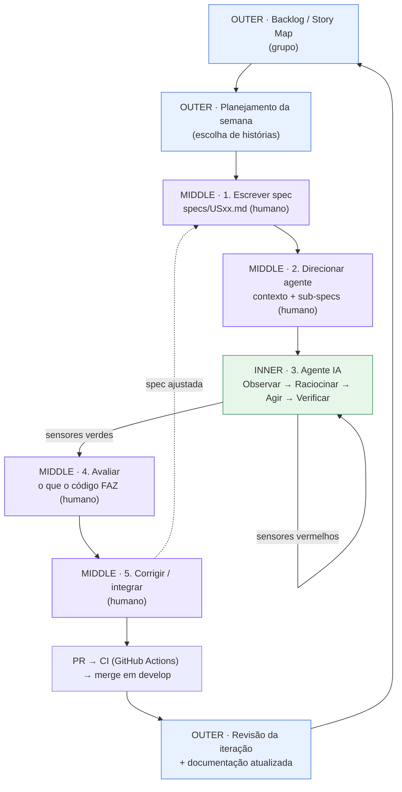

# 1. Descrição do Processo de Desenvolvimento Suportado por IA

> Base conceitual: aula 09 — "A Transição para o SDD" (Prof. Michael Mora). Este item descreve o processo que o Grupo 9 adota no trabalho e que **já foi aplicado na produção deste Pacote 1**.

## 1.1 Visão geral do processo

O Grupo 9 adota **Spec-Driven Development (SDD) com agentes de codificação supervisionados**. A **especificação é a fonte única de verdade**: toda história do backlog vira uma spec versionada no repositório antes de qualquer código; o código (e os testes) são derivados da spec por agentes de IA e **validados contra os critérios de verificação dela**, por sensores automáticos e por revisão humana.

O processo é iterativo e alinhado aos pacotes do enunciado:

| Iteração | Período | Objetivo | Saída principal |
|---|---|---|---|
| I1 — Pacote 1 | até 14/10/2026 | Processo e requisitos | Visão, Story Map, RNFs, mockups, este documento |
| I2 — Pacote 2 | 15/10 → 04/11 | Arquitetura e infraestrutura | C4 (níveis 1–3), modelo de dados, tópicos Kafka, pipeline, GCS; esqueleto dos serviços + docker-compose + CI |
| I3 — Pacote 3 | 05/11 → 23/11 | Checkpoint (MVP) | Histórias da fatia MVP implementadas e testadas |
| I4 — Pacote 4 | 24/11 → 02/12 | Produto completo | Fatia R2, testes de carga, documentação atualizada |

Dentro das iterações I2–I4 trabalhamos em **ciclos semanais** (planejamento na segunda-feira, revisão/integração na quarta, aproveitando as aulas de trabalho).



## 1.2 Ciclo de desenvolvimento

O ciclo segue os três loops da aula 09:

- **Outer loop (governança)** — o grupo mantém o Story Map (item 3), define a fatia da iteração e atualiza a documentação ao fim de cada pacote. Decisões de arquitetura ficam registradas em ADRs (`docs/adr/`).
- **Middle loop (engenharia supervisória — humanos)** — cada integrante, como "dono" de uma história:
  - **Direcionamento:** decompõe a história em blocos do tamanho de um agente, escreve/ajusta a spec e escolhe o contexto (3–5 arquivos relevantes);
  - **Avaliação:** revisa o que o código realmente faz, caçando "alucinações plausíveis" (ex.: lock que não é atômico, consumidor que não é idempotente);
  - **Correção:** integra saídas de agentes paralelos e reconduz à consistência com a spec.
- **Inner loop (agente)** — o agente de codificação lê a spec, gera código e testes, executa compilador/testes/linters e se corrige até os sensores ficarem verdes.

**Fases de uma história (fluxo padrão):**

| # | Fase | Responsável | Artefato / portão |
|---|---|---|---|
| 1 | Seleção da história no Story Map | Grupo | Issue no GitHub ligada à US |
| 2 | Spec da história | Humano (com rascunho por IA) | `specs/USxx-nome.md` aprovada por outro integrante |
| 3 | Decomposição em sub-specs | Agente coordenador + humano | Sub-specs por camada/serviço, sem arquivos em comum |
| 4 | Implementação | Agentes implementadores | Branch `feature/USxx-...` com código + testes |
| 5 | Verificação | Sensores + agente verificador | Testes, cobertura, ArchUnit, relatório do juiz |
| 6 | Pull Request | Humano | PR para `develop` com checklist da spec |
| 7 | CI | GitHub Actions | Lint + testes + build verdes (obrigatório) |
| 8 | Revisão e merge | Outro integrante (humano) | 1 aprovação humana + CI verde → merge |

## 1.3 Ferramentas

| Ferramenta | Uso no processo |
|---|---|
| **Claude Code** (Anthropic, terminal/VS Code) | Agente de codificação principal: geração de specs, código, testes, documentação e diagramas; subagentes paralelos; leitura automática do `CLAUDE.md`; hooks |
| **Antigravity (AGY CLI)** | Alternativa vista no codelab da aula 09, usada para comparação e por integrantes que preferirem **[Decisão do grupo]** |
| **VS Code** | IDE comum, com extensão do Claude Code |
| **GitHub** | Repositório, Issues (backlog), Projects (quadro da iteração), Pull Requests, proteção de branches |
| **GitHub Actions** | CI: lint, testes unitários e de integração (Testcontainers), cobertura (JaCoCo), mutação (PIT), build de imagens; revisão por IA no PR |
| **Docker / Docker Compose** | Ambiente local completo e reprodutível (RNF37) |
| **Java 21, Spring Boot 3, Spring Cloud, Maven** | Back-end dos microsserviços |
| **React + TypeScript (Vite)** | Front-end SPA |
| **JUnit 5, Mockito, Testcontainers, ArchUnit, PIT, k6** | Sensores computacionais (testes, arquitetura, mutação, carga) |
| **Checkstyle/Spotless, ESLint/Prettier, gitleaks** | Linters e varredura de segredos |
| **Mermaid** | Diagramas como código (story map, navegação, ciclo, FSM, C4 no Pacote 2) |
| **HTML/CSS + Chrome headless** | Mockups versionáveis (item 5) e geração do PDF de entrega |

## 1.4 Agentes e papéis

Aplicamos o **Padrão de Agente Adversarial**:

| Papel | Quem | Responsabilidade | Entrada → Saída |
|---|---|---|---|
| **Coordenador (Tech Lead)** | Sessão principal do Claude Code, supervisionada pelo dono da história | Lê a spec raiz e gera sub-specs independentes (ex.: domínio/FSM, adaptador de persistência, consumidor Kafka, tela React) | `specs/USxx.md` → `specs/USxx/*.md` |
| **Implementadores** | Subagentes do Claude Code (em paralelo) ou sessões separadas de cada integrante | Implementam uma sub-spec cada, com testes | Sub-spec → código + testes na branch |
| **Verificador (Juiz)** | Subagente separado com prompt de "revisor adversarial" (sem acesso ao raciocínio do implementador) + revisão de PR por IA no CI | Avalia **estritamente contra os critérios de verificação** da spec e procura violações (overselling, falta de idempotência, segredo exposto, transição de FSM inválida) | Diff + spec → lista de violações |
| **Supervisor humano** | Integrante dono da história; outro integrante revisa o PR | Direciona, avalia e corrige; decide o merge. **Nenhum código vai para `develop` sem revisão humana** | — |

**Como evitamos colisão de arquivos:**
- Cada sub-spec declara explicitamente os **arquivos/pacotes que pode alterar**; o coordenador só gera sub-specs com conjuntos disjuntos.
- Arquitetura hexagonal por serviço (domínio, aplicação, adaptadores) facilita a divisão.
- Cada integrante trabalha em sua `feature/*`; integração apenas via PR.
- Divisão inicial de responsabilidade por módulo **[Decisão do grupo — a confirmar na I2]**: Gabriel — IAM + Telemetria/DevOps; Mateus — Inventário + Checkout; Filipe — Ingressos/Notificações + Front-end. Revisões de PR são cruzadas.

## 1.5 Specs utilizadas

**Local:** pasta `specs/` na raiz do repositório, uma spec por história (`specs/US18-reservar-assento.md`), sub-specs em subpasta (`specs/US18/`). Specs são versionadas e revisadas em PR como código.

**Nível de maturidade de SDD escolhido: "spec-anchored"** (intermediário) — a spec é escrita antes, permanece no repositório e é **atualizada junto com o código** quando o comportamento muda; não chegamos a "spec-as-source" (gerar todo o código só a partir da spec, sem editar código) porque o não-determinismo do LLM e o prazo exigem ajustes manuais. Dosamos o peso: bugfix pequeno não exige spec completa (só issue + teste que reproduz); histórias de risco alto (concorrência, pagamento, segurança) exigem spec completa e verificador.

**Template (6 elementos):**

```markdown
# USxx — <título>
## 1. Objetivo            — o que e por quê (liga à história do Story Map)
## 2. Contexto            — serviço, arquivos relevantes, decisões/ADRs aplicáveis
## 3. Restrições          — regras inegociáveis (ex.: zero overselling, sem escrita direta no Kafka)
## 4. Interfaces/Contratos — endpoints (OpenAPI), eventos Kafka (esquema), tabelas
## 5. Critérios de aceitação e verificação — Dado/Quando/Então + testes obrigatórios + métricas
## 6. Fora de escopo      — o que o agente NÃO deve fazer
```

Seguindo a mitigação de *"lost in the middle"*, as **restrições inegociáveis ficam no início** da spec e os **critérios de verificação/testes no fim**.

**Exemplo — `specs/US18-reservar-assento.md` (resumida):**

> **1. Objetivo.** Permitir que o Cliente reserve de 1 a 6 assentos atomicamente por 10 minutos (US18, US19).
> **2. Contexto.** `inventory-service`; pacote `domain.reserva`; Redis para lock com TTL; PostgreSQL como fonte da verdade; ADR-003 (estratégia de lock).
> **3. Restrições.** Tudo-ou-nada; zero overselling (RNF01); TTL exato de 600 s; devolução atômica na expiração; evento `ReservaExpirada` publicado **somente via Outbox**; domínio sem dependência de Spring (ArchUnit).
> **4. Interfaces.** `POST /eventos/{id}/reservas` (header `Idempotency-Key`, corpo `{assentos:[...]}`) → `201 {reservaId, expiraEm}` · `409` assento indisponível · evento `inventario.reserva-expirada.v1 {eventId, reservaId, assentos[], ocorridoEm}`.
> **5. Verificação.** (a) teste de integração com Testcontainers: 50 threads no mesmo assento → exatamente 1 sucesso; (b) teste com `Clock` controlado: expira em 600 s ± 5 s; (c) falha injetada no 3º assento → nenhum bloqueado; (d) cobertura de domínio ≥ 70%; (e) juiz confirma ausência de escrita direta no Kafka.
> **6. Fora de escopo.** Fila virtual; pagamento; WebSocket (US20).

## 1.6 Harness: controles feedforward e feedback

**Agente = LLM + harness.** O harness do grupo:

**Controles feedforward (preventivos)**
- **`CLAUDE.md` na raiz** (constituição do projeto), lido automaticamente no início de cada sessão: regras inegociáveis no topo (idioma, requisitos do domínio, proibição de segredos, pastas que não podem ser alteradas), mapa de pastas, tarefa atual e critérios de verificação no fim.
- **Progressive disclosure:** o `CLAUDE.md` é enxuto e aponta para documentos específicos (plano do pacote, enunciado, specs) em vez de colar tudo no contexto.
- **Skills / comandos reutilizáveis** em `.claude/` (ex.: `/nova-spec` gera spec a partir do template; `/verificar` roda o juiz contra a spec; `/pacote1` iniciou este pacote).
- **Templates e convenções:** template de spec, de PR (checklist com critérios da spec) e de ADR; convenção de commits (*Conventional Commits*).
- **Hooks do Claude Code:** bloquear edição de arquivos protegidos (`contexto/`, `.env`) e rodar formatador após edições.

**Controles feedback (sensores)**
- **Computacionais:** compilação; testes unitários da FSM e regras de domínio (**≥ 70% de cobertura de domínio**, JaCoCo como *gate*); testes de integração com **Testcontainers** (PostgreSQL, Kafka, Redis); **ArchUnit** (fitness functions: domínio sem framework, sem acesso a banco de outro serviço, sem `KafkaTemplate` em caso de uso); **PIT** (mutação ≥ 70%); linters; **gitleaks**; k6 (carga).
- **Inferenciais:** **LLM-as-a-judge** — subagente verificador local e revisão automática de PR por IA no GitHub Actions, avaliando aderência à spec, nomenclatura, cobertura dos critérios e segurança. O parecer do juiz é consultivo; o portão final é humano.

## 1.7 Integração com GCS e CI/CD

(Detalhamento completo do GCS no Pacote 2.)

- **Branches (Git Flow simplificado):** `main` (versões entregues por pacote, com *tag* `pacote-N`), `develop` (integração), `feature/USxx-descricao`, `fix/...`, `docs/...`.
- **Regras:** proibido *push* direto em `main` e `develop`; todo merge via **Pull Request** com **CI verde** + **1 aprovação humana** de outro integrante; PR referencia a issue e a spec; *squash merge* em `develop`.
- **CI (GitHub Actions)** a cada PR e merge em `develop`: lint → testes unitários + cobertura → testes de integração (Testcontainers) → ArchUnit → build das imagens → revisão por IA (comentário no PR).
- **CD:** merge em `main` gera imagens versionadas (GHCR) e o `docker-compose.yml` de demonstração.
- **Specs e documentação** passam pelo mesmo fluxo de PR — mudança de comportamento sem atualização da spec é motivo de reprovação no review.

## 1.8 Riscos do uso de IA e mitigação

| Risco | Mitigação no processo |
|---|---|
| *Lost in the middle* / contexto longo | `CLAUDE.md` enxuto; regras no início e verificação no fim; contexto filtrado (3–5 trechos); revelação progressiva (um entregável/sub-spec por vez) |
| Alucinação plausível (código que parece certo mas viola concorrência/idempotência) | Critérios de verificação objetivos na spec; testes de integração reais; agente juiz adversarial; revisão humana focada no comportamento |
| Débito cognitivo e de intenção (*Triple Debt*) | Dono humano por história, que precisa explicar o código no review; specs e ADRs registram a intenção |
| Segredos em código | Regra no `CLAUDE.md`; `.env` fora do Git; gitleaks no CI; hooks bloqueando edição de `.env` |
| Não-determinismo (mesma spec → código diferente) | Sensores determinísticos como portão; testes baseados em propriedades para a FSM (jqwik) |
| Copy-paste / duplicação | Revisão de PR, linters e análise estática |
| Custo de tokens | Rigor proporcional ao risco; subagentes só para histórias grandes; reuso de skills |
| Dependência excessiva da ferramenta | Todo integrante deve conseguir rodar, testar e explicar qualquer parte do sistema sem a IA |

## 1.9 Evidência: como este Pacote 1 foi produzido

O próprio Pacote 1 seguiu o processo descrito acima:
1. **Spec raiz:** `CLAUDE.md` (regras inegociáveis + critérios de verificação) e `pacote-1/PLANO-PACOTE-1.md` (tabela "Pronto quando…" por entregável), escritos pelo grupo a partir do enunciado (`contexto/01-enunciado-projeto-final.md`, tratado como fonte de verdade e protegido contra alteração).
2. **Direcionamento:** `pacote-1/PROMPT-INICIAL.md` definiu a ordem (Visão → RNFs → Story Map → Mockups → Processo) — revelação progressiva, um entregável por vez.
3. **Inner loop:** o Claude Code (VS Code) gerou cada documento, os mockups HTML e os diagramas Mermaid.
4. **Verificação adversarial** após cada entregável, item a item contra o plano (ex.: a verificação encontrou e corrigiu soma incorreta de pontos no backlog e uma legenda de módulo inexistente nos RNFs; ajustou anotações que sobrepunham conteúdo nos mockups).
5. **Supervisão humana:** o grupo revisou o conteúdo, validou as decisões marcadas como **[Decisão do grupo]** e gerou o PDF de entrega.
