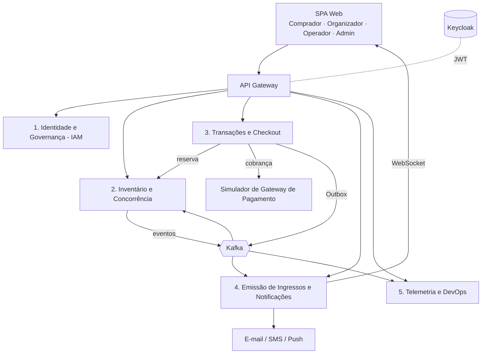

# 2. Documento de Visão do Produto

> Versão 1.0 — 14/10/2026 · Grupo 9 · Será atualizado nos Pacotes 3 e 4.
> Itens marcados com **[Decisão do grupo]** são extrapolações nossas sobre o enunciado.

## 2.1 Introdução e propósito

Este documento descreve a visão do produto a ser construído no Projeto Integrador de Construção de Software (PUCRS 2026/2): uma **plataforma distribuída de bilhetagem, reserva e acesso para megaeventos**. Ele define o problema, os usuários, o escopo funcional (cinco módulos), as restrições técnicas e os critérios de sucesso. É a referência para o Backlog (item 3), os Requisitos Não-Funcionais (item 4) e os Mockups (item 5).

## 2.2 Nome do produto

**PulsePass** — nome sugerido no enunciado e adotado pelo grupo **[Decisão do grupo]**. A ideia de "pulso" remete ao pico de tráfego na abertura das vendas e ao acompanhamento em tempo real; "pass" remete ao ingresso/acesso.

## 2.3 Problema

| Aspecto | Descrição |
|---|---|
| **O problema** | Na abertura de vendas de megaeventos (shows, festivais, finais esportivas), dezenas de milhares de compradores chegam no mesmo instante (*flash crowd*). Sistemas baseados só em HTTP síncrono esgotam conexões de banco, ficam lentos ou caem, e falhas de concorrência vendem o mesmo assento duas vezes (*overselling*). |
| **Afeta** | Compradores (frustração, cobrança sem ingresso), organizadores (prejuízo financeiro e de imagem, reembolsos), operadores de acesso (fraude e filas na portaria). |
| **Impacto** | Perda de receita, reclamações em massa, ingressos duplicados ou falsificados, retrabalho manual de conciliação entre pagamentos e ingressos. |
| **Uma solução bem-sucedida** | Aguenta o pico com degradação controlada (fila/limitação), garante **zero overselling**, libera automaticamente assentos de reservas não pagas em **10 minutos**, emite ingressos seguros (PDF + QR Code) e dá visibilidade em tempo real a todos os envolvidos. |

## 2.4 Oportunidade / posicionamento

**Para** organizadores de grandes eventos e seus públicos, **que** precisam vender milhares de ingressos em minutos sem erros, **o PulsePass é** uma plataforma de bilhetagem distribuída **que** combina bloqueio concorrente de assentos, checkout resiliente orientado a eventos e emissão assíncrona de ingressos. **Diferente de** sistemas monolíticos síncronos, **nosso produto** é baseado em microsserviços e mensageria (Kafka), isola o pico de leitura do catálogo do fluxo transacional e garante consistência entre banco e broker com o padrão *Transactional Outbox*.

## 2.5 Stakeholders

| Stakeholder | Interesse | Responsabilidade no projeto |
|---|---|---|
| Prof. Michael da Costa Mora | Avaliar aplicação de arquitetura, testes, DevOps e processo com IA | Cliente acadêmico / avaliador |
| Grupo 9 (Gabriel, Mateus, Filipe) | Entregar produto e documentação de qualidade | Equipe de desenvolvimento (com agentes de IA supervisionados) |
| Organizadores de eventos | Vender sem overselling, acompanhar vendas | Usuário de negócio / fonte de requisitos |
| Compradores (público) | Comprar rápido e com segurança | Usuário final |
| Operadores de acesso | Validar ingressos na entrada | Usuário operacional |
| Administradores da plataforma | Governança, segurança, saúde do sistema | Usuário técnico/gestor |
| Gateway de pagamento (simulado) | Receber requisições de cobrança e notificar resultado | Sistema externo |
| Serviço de e-mail/SMS/push | Entregar comprovantes | Sistema externo |

## 2.6 Usuários e perfis (RBAC)

Os perfis correspondem aos papéis RBAC exigidos pelo enunciado e são gerenciados no **Keycloak**.

| Perfil | Quem é | Objetivos principais | Permissões resumidas |
|---|---|---|---|
| **Cliente (Comprador)** | Pessoa do público geral | Encontrar evento, escolher assento, pagar, receber ingresso | Ver catálogo, criar reserva/pedido, pagar, ver/baixar os próprios ingressos |
| **Organizador** | Produtora ou empresa que realiza o evento | Cadastrar eventos, lotes e mapas de assentos; acompanhar vendas | CRUD dos próprios eventos, lotes e mapas; ver relatórios dos próprios eventos |
| **Operador** | Equipe de portaria / suporte no local | Validar ingressos (QR Code) e apoiar o público | Validar check-in, consultar status de ingresso/pedido de eventos atribuídos |
| **Admin** | Equipe da plataforma | Aprovar organizadores, gerir usuários e papéis, auditar, monitorar | Gestão de usuários/papéis, aprovação de organizadores, trilha de auditoria, painel de telemetria |

## 2.7 Visão geral do produto e módulos

O PulsePass é composto por uma **SPA** (front-end web) que consome APIs através de um **API Gateway**, e por microsserviços que se comunicam de forma síncrona (REST) apenas quando necessário e de forma assíncrona via **Kafka** nos demais casos.

| # | Módulo | Responsabilidade | Destaques técnicos |
|---|---|---|---|
| 1 | **Identidade e Governança (IAM)** | Autenticação, autorização, cadastro e auditoria | Keycloak; JWT stateless assinado; refresh token em chave-valor (Redis); RBAC com 4 papéis; trilha de auditoria de credenciais; gestão cadastral de organizadores |
| 2 | **Inventário e Concorrência** | Eventos, lotes, mapas de assentos e bloqueio | Catálogo de alta leitura (cache); alocação e devolução **atômicas** de assentos; lock com TTL de 10 min; publica `ReservaExpirada` no Kafka |
| 3 | **Transações e Checkout** | Pedido e pagamento | FSM **Criado → Reservado → Aguardando → Pago / Expirado**; `Idempotency-Key` no header; **Transactional Outbox** em transação ACID (PostgreSQL) → Kafka; integração com simulador de gateway |
| 4 | **Mensageria e Despacho (Ingressos e Notificações)** | Emissão e entrega do ingresso | Consome `PagamentoConfirmado`; consumo idempotente; PDF com carimbo de tempo e **QR Code** assinado; envio multicanal; atualização de tela em tempo real via **WebSocket** |
| 5 | **Análise e Operações (Telemetria e DevOps)** | Métricas, painéis e automação | Ingestão de eventos de navegação e compra; painel em tempo real; Prometheus/Grafana; CI no GitHub Actions; ambiente completo em docker-compose |

## 2.8 Funcionalidades principais

**Comprador**
- F01 — Cadastro/login (Keycloak) e recuperação de sessão via refresh token.
- F02 — Navegar no catálogo de eventos (busca, filtros por data/cidade/categoria).
- F03 — Visualizar mapa de assentos com disponibilidade atualizada em tempo real.
- F04 — Reservar assento(s) com contagem regressiva de 10 minutos.
- F05 — Pagar o pedido (simulador de gateway) com proteção contra clique duplo (Idempotency-Key).
- F06 — Receber ingresso em PDF com QR Code por e-mail e na área "Meus ingressos", com aviso em tempo real.

**Organizador**
- F07 — Solicitar cadastro como organizador (aprovado pelo Admin).
- F08 — Criar evento, lotes (preço, quantidade, janela de vendas) e mapa de assentos por setor.
- F09 — Publicar/encerrar vendas e acompanhar vendas por lote em tempo real.

**Operador**
- F10 — Validar ingresso por leitura de QR Code (válido, já utilizado, inválido).
- F11 — Consultar status de pedido/ingresso para suporte no local.

**Admin**
- F12 — Aprovar/bloquear organizadores e gerir usuários e papéis.
- F13 — Consultar trilha de auditoria de credenciais (logins, falhas, revogações, mudanças de papel).
- F14 — Painel de telemetria: vendas por minuto, reservas ativas/expiradas, latência, erros, lag do Kafka.

**Transversais**
- F15 — Expiração automática de reservas e devolução atômica do assento ao estoque.
- F16 — Pipeline de CI/CD e ambiente reproduzível em docker-compose.

## 2.9 Restrições e premissas

**Restrições do enunciado (obrigatórias)**
- R01 — **Zero overselling**: um assento nunca pode estar vinculado a dois pedidos pagos.
- R02 — **Reserva temporária expira estritamente em 10 minutos**, devolvendo o assento ao estoque.
- R03 — Estilo arquitetural de **microsserviços**.
- R04 — Provedor de identidade **Keycloak ou Cognito** → adotamos **Keycloak** (roda localmente em container, sem custo de nuvem) **[Decisão do grupo]**.
- R05 — **Kafka** como provedor de streaming.
- R06 — Tratar o **dilema da escrita dupla** (Transactional Outbox) e a **idempotência no consumo**.
- R07 — FSM do pedido com os estados **Criado, Reservado, Aguardando, Pago, Expirado**.
- R08 — Suporte a **Idempotency-Key** em cabeçalhos HTTP.
- R09 — Testes unitários das máquinas de estado com **≥ 70% de cobertura de domínio**; integração com **Testcontainers** (PostgreSQL, Kafka, Redis).
- R10 — Ambiente completo via **docker-compose.yml** (backend, frontend, bancos, Kafka e UI de mensageria).
- R11 — CI no **GitHub Actions** executando linters, testes e build a cada Pull Request ou merge na branch `develop`.
- R12 — Processo de desenvolvimento **suportado por IA** e documentado.

**Premissas / decisões do grupo**
- P01 — Back-end em **Java 21 + Spring Boot 3 + Spring Cloud** (Gateway, Config), coerente com os exercícios da disciplina **[Decisão do grupo]**.
- P02 — Front-end SPA em **React + TypeScript (Vite)** **[Decisão do grupo]**.
- P03 — **PostgreSQL** (um banco por serviço — *Database per Service*), **Redis** (refresh tokens, locks/TTL de reserva e cache do catálogo) **[Decisão do grupo]**.
- P04 — UI de mensageria: **Kafka UI** (provectus/kafbat) **[Decisão do grupo]**.
- P05 — Observabilidade com **OpenTelemetry + Prometheus + Grafana** (já vistos na disciplina).
- P06 — Pagamento e notificações são **simulados** (sem integração bancária ou provedores reais).
- P07 — Execução local/acadêmica; não há implantação em produção na nuvem.

## 2.10 Fora de escopo

- Integração com gateways bancários reais, emissão fiscal e split de pagamentos.
- Reembolso/cancelamento solicitado pelo comprador após o pagamento (apenas registro de requisito futuro).
- Revenda/transferência de ingressos entre usuários (mercado secundário).
- Aplicativo móvel nativo (a SPA será responsiva; a leitura de QR no operador usa a câmera via navegador).
- Fila virtual de espera completa estilo "sala de espera" (apenas limitação de taxa no gateway, podendo evoluir em release futura).
- Implantação em Kubernetes ou nuvem pública; alta disponibilidade multi-região.
- Envio real de SMS/push (simulado; e-mail via servidor de teste, ex.: MailHog/Mailpit).

## 2.11 Critérios de sucesso

| # | Critério | Como será medido |
|---|---|---|
| CS1 | Zero overselling sob concorrência | Teste de carga com ≥ 1.000 compradores simultâneos disputando 100 assentos: exatamente 100 pedidos pagos, 0 assentos duplicados |
| CS2 | Expiração em 10 min | Teste automatizado: reserva não paga volta ao estoque entre 10:00 e 10:05 min |
| CS3 | Consistência banco ↔ Kafka | Teste de integração com falha simulada do broker: nenhum evento de pagamento perdido nem duplicado em efeito (Outbox + consumidor idempotente) |
| CS4 | Fluxo ponta a ponta | Demonstração: comprador reserva, paga e recebe PDF com QR Code; operador valida o QR; organizador e admin veem o painel atualizado |
| CS5 | Qualidade e reprodutibilidade | `docker compose up` sobe todo o ambiente; CI verde em todo PR para `develop`; cobertura de domínio ≥ 70% |
| CS6 | Processo com IA rastreável | Specs versionadas no repositório para cada história implementada, com evidência de verificação |
| CS7 | Entregas no prazo | Pacotes 1–4 entregues nas datas do cronograma (14/10, 04/11, 23/11, 02/12/2026) |
