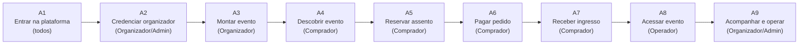
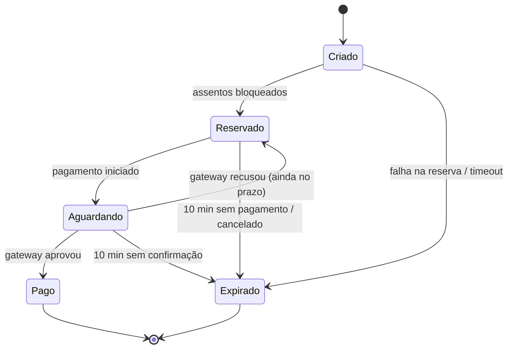

# 3. Backlog com Épicos e Histórias de Usuários no Formato de Story Mapping

> Técnica: *User Story Mapping* (Jeff Patton). O **backbone** (eixo horizontal) é a jornada dos usuários; abaixo de cada atividade ficam as histórias, ordenadas verticalmente por prioridade e fatiadas em releases.
> Releases **[Decisão do grupo]**: **MVP** = Pacote 3 (checkpoint 23/11/2026) · **R2** = Pacote 4 (produto completo 02/12/2026) · **R3** = evolução futura (fora do prazo da disciplina, registrada para priorização).

## 3.1 Backbone (atividades do usuário, da esquerda para a direita)

A jornada principal é a do **Comprador**; à esquerda dela está a preparação feita pelo **Organizador** e pelo **Admin**, e à direita o acesso no dia (feito pelo **Operador**) e a análise (Organizador/Admin).

| Atividade | A1 Entrar na plataforma | A2 Credenciar organizador | A3 Montar evento | A4 Descobrir evento | A5 Reservar assento | A6 Pagar pedido | A7 Receber ingresso | A8 Acessar evento | A9 Acompanhar e operar |
|---|---|---|---|---|---|---|---|---|---|
| **Tarefas do usuário** | Criar conta, logar, manter sessão, sair | Solicitar credenciamento, aprovar, gerir papéis, auditar | Criar evento, definir lotes, desenhar mapa, publicar | Buscar, filtrar, ver detalhes | Ver mapa, escolher, bloquear, acompanhar tempo | Revisar pedido, pagar, ver resultado | Ser notificado, baixar PDF, ver QR | Ler QR, validar, consultar | Ver vendas, métricas, saúde, pipeline |

## 3.2 Épicos

| ID | Épico | Módulo do enunciado | Atividades |
|---|---|---|---|
| **EP1** | Identidade, autenticação e sessão | Identidade e Governança (IAM) | A1 |
| **EP2** | Governança: organizadores, papéis e auditoria | Identidade e Governança (IAM) | A2 |
| **EP3** | Gestão de eventos, lotes e mapas de assentos | Inventário e Concorrência | A3 |
| **EP4** | Catálogo de alta leitura | Inventário e Concorrência | A4 |
| **EP5** | Reserva concorrente de assentos | Inventário e Concorrência | A5 |
| **EP6** | Pedido, checkout e pagamento resiliente | Transações e Checkout | A6 |
| **EP7** | Emissão de ingressos e notificações | Mensageria e Despacho | A7 |
| **EP8** | Controle de acesso no evento | Mensageria e Despacho (+ IAM) | A8 |
| **EP9** | Telemetria e painéis em tempo real | Análise e Operações | A9 |
| **EP10** | DevOps: ambiente, CI/CD e qualidade | Análise e Operações | A9 (transversal) |

## 3.3 Story Map (atividades × histórias, fatiado por release)

Cada célula lista os IDs das histórias (detalhadas em 3.4). De cima para baixo: maior → menor prioridade.

| Release | A1 Entrar | A2 Credenciar | A3 Montar evento | A4 Descobrir | A5 Reservar | A6 Pagar | A7 Receber ingresso | A8 Acessar evento | A9 Acompanhar/operar |
|---|---|---|---|---|---|---|---|---|---|
| **MVP** (Pacote 3) | US01 Login Keycloak US02 Cadastro comprador US03 Refresh token | US05 Solicitar credenciamento US06 Aprovar organizador | US09 Criar evento US10 Criar lotes US11 Mapa de assentos US12 Publicar vendas | US14 Listar eventos US15 Detalhe do evento | US17 Ver mapa de assentos US18 Reservar assento US19 Expirar reserva em 10 min | US21 Criar pedido (FSM) US22 Pagar com Idempotency-Key US23 Outbox → Kafka | US25 Emitir ingresso PDF + QR US26 Meus ingressos | US29 Validar QR Code | US32 Docker Compose completo US33 CI no GitHub Actions |
| **R2** (Pacote 4) | US04 Logout e revogação | US07 Gerir papéis (RBAC) US08 Trilha de auditoria | US13 Editar/encerrar lote | US16 Busca e filtros (cache) | US20 Disponibilidade em tempo real US20b Cancelar reserva | US24 Pagamento recusado / gateway fora | US27 Enviar comprovante por e-mail US28 Aviso em tempo real (WebSocket) | US30 Consultar ingresso/pedido | US34 Painel de vendas do organizador US35 Painel de telemetria (Admin) US36 Ingestão de eventos de navegação |
| **R3** (futuro) | Login social | Convite de operadores por evento | Duplicar evento | Recomendações | Fila virtual de espera | Reembolso / cancelamento pós-pago | SMS / push reais; carteira digital | Validação offline no celular | US37 Alertas operacionais; testes de carga contínuos |

## 3.4 Histórias de usuário detalhadas

Formato: *Como «papel», quero «ação», para «benefício»* + critérios de aceitação em Gherkin (Dado/Quando/Então). Prioridade MoSCoW (M = Must, S = Should, C = Could). Estimativa em pontos (Fibonacci) **[Decisão do grupo]**.

### EP1 — Identidade, autenticação e sessão (IAM)

**US01 — Login via Keycloak** · M · MVP · 5 pts
*Como* usuário de qualquer perfil, *quero* fazer login com e-mail e senha, *para* acessar as funções do meu papel com segurança.
- Dado um usuário cadastrado, quando informa credenciais válidas, então recebe um access token JWT (RS256, validade ≤ 5 min) e um refresh token, e é redirecionado à tela inicial do seu papel.
- Dado credenciais inválidas, quando tenta logar, então vê "E-mail ou senha inválidos" e a falha é registrada na auditoria.
- Dado um token ausente, expirado ou adulterado, quando chama uma rota protegida, então recebe HTTP 401.

**US02 — Cadastro de comprador** · M · MVP · 3 pts
*Como* visitante, *quero* criar uma conta de comprador, *para* poder reservar e comprar ingressos.
- Dado e-mail não cadastrado e senha que atende à política (≥ 8 caracteres, letra e número), quando envio o cadastro, então a conta é criada no Keycloak com o papel **Cliente**.
- Dado e-mail já cadastrado, quando envio o cadastro, então vejo mensagem de conflito e nenhuma conta nova é criada.

**US03 — Renovação de sessão com refresh token** · M · MVP · 3 pts
*Como* comprador, *quero* que minha sessão seja renovada automaticamente, *para* não perder minha reserva no meio do checkout.
- Dado um refresh token válido armazenado no Redis, quando o access token expira, então a SPA obtém um novo par de tokens sem intervenção do usuário.
- Dado um refresh token já utilizado (rotacionado), quando é reapresentado, então é rejeitado e todos os tokens daquela sessão são revogados.

**US04 — Logout e revogação** · S · R2 · 2 pts
*Como* usuário, *quero* sair da plataforma, *para* impedir uso indevido da minha conta.
- Dado um usuário logado, quando clica em "Sair", então o refresh token é removido do Redis em ≤ 5 s e novas renovações falham.

### EP2 — Governança: organizadores, papéis e auditoria (IAM)

**US05 — Solicitar credenciamento de organizador** · M · MVP · 3 pts
*Como* produtora de eventos, *quero* solicitar cadastro como organizador informando razão social, CNPJ e contato, *para* poder vender ingressos na plataforma.
- Dado um CNPJ válido e ainda não cadastrado, quando envio a solicitação, então ela fica com status **Pendente** e o Admin é notificado.
- Dado um CNPJ inválido, quando envio, então vejo erro de validação.

**US06 — Aprovar/recusar organizador** · M · MVP · 3 pts
*Como* Admin, *quero* aprovar ou recusar solicitações de organizadores, *para* garantir que só empresas legítimas criem eventos.
- Dado uma solicitação Pendente, quando aprovo, então a conta recebe o papel **Organizador** e a ação é registrada na auditoria.
- Dado uma solicitação recusada, quando o solicitante tenta criar evento, então recebe HTTP 403.

**US07 — Gerir usuários e papéis (RBAC)** · S · R2 · 5 pts
*Como* Admin, *quero* atribuir e remover papéis (Cliente, Organizador, Operador, Admin) e bloquear usuários, *para* aplicar o menor privilégio.
- Dado um usuário, quando atribuo o papel Operador vinculado a um evento, então ele passa a ver a tela de validação apenas daquele evento.
- Dado um usuário bloqueado, quando tenta logar ou renovar sessão, então o acesso é negado.
- Toda alteração de papel gera registro de auditoria com autor, alvo, papel e data/hora.

**US08 — Trilha de auditoria de credenciais** · S · R2 · 5 pts
*Como* Admin, *quero* consultar a trilha de auditoria de credenciais, *para* investigar acessos suspeitos.
- Dado eventos de login, falha, refresh, logout, revogação e mudança de papel, quando filtro por usuário e período, então vejo os registros com IP, data/hora (UTC) e resultado.
- Registros de auditoria não podem ser alterados nem excluídos pela API.

### EP3 — Gestão de eventos, lotes e mapas de assentos (Inventário)

**US09 — Criar evento** · M · MVP · 3 pts
*Como* organizador, *quero* cadastrar um evento com nome, descrição, local, data/hora e imagem, *para* divulgá-lo no catálogo.
- Dado um organizador aprovado, quando salvo o evento com campos obrigatórios, então ele é criado com status **Rascunho**, visível só para mim.
- Dado um organizador de outra empresa, quando tenta editar meu evento, então recebe HTTP 403.

**US10 — Criar lotes** · M · MVP · 3 pts
*Como* organizador, *quero* definir lotes com preço, quantidade e janela de vendas, *para* controlar a precificação.
- Dado um evento em Rascunho, quando crio o lote "1º lote – Pista – R$ 150 – 500 un. – 01/11 a 10/11", então ele aparece na lista de lotes do evento.
- Dado uma janela de vendas que termina depois do evento, quando salvo, então vejo erro de validação.

**US11 — Mapa de assentos por setor** · M · MVP · 8 pts
*Como* organizador, *quero* montar o mapa de setores, fileiras e assentos (numerados ou pista sem numeração), *para* que o comprador escolha seu lugar.
- Dado um setor numerado com 20 fileiras × 30 assentos, quando salvo, então 600 assentos são gerados com identificador único e status **Disponível**.
- Dado um setor de pista, quando defino capacidade 2.000, então o estoque é controlado por quantidade (sem numeração), com as mesmas garantias de atomicidade.

**US12 — Publicar e encerrar vendas** · M · MVP · 2 pts
*Como* organizador, *quero* publicar o evento, *para* que ele apareça no catálogo e as vendas abram na data configurada.
- Dado um evento com ao menos um lote e mapa, quando publico, então ele aparece no catálogo e o cache do catálogo é invalidado em ≤ 5 s.
- Dado um evento sem lote, quando tento publicar, então a publicação é bloqueada com mensagem explicativa.

**US13 — Editar ou encerrar lote** · S · R2 · 3 pts
*Como* organizador, *quero* encerrar um lote antes do fim, *para* abrir o próximo lote.
- Dado um lote com reservas ativas, quando o encerro, então novas reservas são bloqueadas, mas as reservas ativas podem ser pagas até expirarem.

### EP4 — Catálogo de alta leitura (Inventário)

**US14 — Listar eventos** · M · MVP · 3 pts
*Como* comprador, *quero* ver a lista de eventos publicados, *para* escolher o que comprar.
- Dado eventos publicados, quando acesso a home, então vejo cartões com nome, data, cidade, menor preço e indicador "Esgotado" quando aplicável.
- A listagem é servida por cache (RNF09: p95 ≤ 200 ms a 2.000 req/s).

**US15 — Detalhe do evento** · M · MVP · 2 pts
*Como* comprador, *quero* ver os detalhes do evento e os lotes à venda, *para* decidir o setor e o preço.
- Dado um evento com vendas abertas, quando abro o detalhe, então vejo descrição, local, lotes ativos com preço e botão "Escolher assentos".
- Dado um evento com vendas ainda não abertas, então vejo a contagem regressiva para a abertura e o botão desabilitado.

**US16 — Busca e filtros** · S · R2 · 3 pts
*Como* comprador, *quero* buscar por nome e filtrar por cidade, data e categoria, *para* encontrar eventos rapidamente.
- Dado o termo "festival" e o filtro "Porto Alegre", quando busco, então vejo apenas eventos publicados que atendem aos dois critérios.

### EP5 — Reserva concorrente de assentos (Inventário)

**US17 — Ver mapa de assentos** · M · MVP · 5 pts
*Como* comprador, *quero* ver o mapa do setor com assentos disponíveis, reservados e vendidos, *para* escolher meu lugar.
- Dado um setor, quando abro o mapa, então cada assento aparece com cor/legenda por status e preço do lote.

**US18 — Reservar assento atomicamente** · M · MVP · 8 pts
*Como* comprador, *quero* reservar até 6 assentos de uma vez, *para* garantir meus lugares enquanto pago.
- Dado assentos Disponíveis, quando confirmo a seleção, então todos são bloqueados atomicamente (tudo-ou-nada) por 10 min, um pedido é criado e eu vejo a contagem regressiva.
- Dado que outro comprador reservou um dos assentos um instante antes, quando confirmo, então **nenhum** assento é bloqueado e vejo "Assento indisponível, escolha outro".
- Dado 1.000 compradores disputando o mesmo assento ao mesmo tempo, então exatamente 1 reserva é concedida (**zero overselling**, RNF01).
- Dado que excedo o limite de 6 assentos por pedido, então a reserva é recusada.

**US19 — Expirar reserva em 10 minutos** · M · MVP · 5 pts
*Como* organizador, *quero* que reservas não pagas expirem automaticamente em 10 minutos, *para* que os assentos voltem à venda.
- Dado uma reserva criada às 20:00:00 e não paga, quando chega 20:10:00, então em até 5 s o pedido vai para **Expirado**, os assentos voltam a **Disponível** atomicamente e o evento `ReservaExpirada` é publicado no Kafka.
- Dado que o pagamento é confirmado às 20:09:59, então a reserva **não** expira (a transição para Pago prevalece e a expiração tardia é ignorada de forma idempotente).
- O comprador vê na tela "Sua reserva expirou" e pode escolher novos assentos.

**US20 — Disponibilidade em tempo real** · S · R2 · 5 pts
*Como* comprador, *quero* que o mapa de assentos se atualize sozinho, *para* não tentar reservar lugares já ocupados.
- Dado dois compradores com o mesmo mapa aberto, quando um reserva um assento, então ele aparece como Reservado na tela do outro em ≤ 2 s (WebSocket).

**US20b — Cancelar reserva** · C · R2 · 2 pts
*Como* comprador, *quero* desistir da reserva antes de pagar, *para* liberar os assentos para outras pessoas.
- Dado uma reserva ativa, quando clico em "Cancelar reserva", então o pedido vai para **Expirado** (motivo: cancelado pelo usuário) e os assentos são devolvidos atomicamente.

### EP6 — Pedido, checkout e pagamento resiliente (Checkout)

**US21 — Pedido com máquina de estados** · M · MVP · 8 pts
*Como* comprador, *quero* acompanhar o status do meu pedido, *para* saber se a compra foi concluída.
- O pedido segue a FSM: **Criado** (itens escolhidos) → **Reservado** (assentos bloqueados) → **Aguardando** (pagamento enviado ao gateway) → **Pago**; de Criado, Reservado ou Aguardando pode ir para **Expirado**.
- Dado um pedido Pago, quando chega um evento de expiração, então ele permanece Pago (transição inválida rejeitada e registrada).
- Dado um pedido Expirado, quando chega confirmação de pagamento tardia, então o pedido não volta para Pago e é gerado evento para estorno simulado.

**US22 — Pagar com Idempotency-Key** · M · MVP · 5 pts
*Como* comprador, *quero* que um clique duplo ou uma reconexão não me cobre duas vezes, *para* pagar com segurança.
- Dado uma requisição `POST /pedidos/{id}/pagamento` com cabeçalho `Idempotency-Key: <uuid>`, quando ela é reenviada com a mesma chave, então a resposta original é devolvida e o gateway é chamado apenas uma vez.
- Dado uma requisição sem `Idempotency-Key`, então a API responde HTTP 400.
- Dado a mesma chave com corpo diferente, então a API responde HTTP 422.

**US23 — Publicação confiável via Transactional Outbox** · M · MVP · 8 pts
*Como* time da plataforma, *quero* que a mudança de estado do pedido e o evento correspondente sejam gravados na mesma transação, *para* nunca emitir ingresso sem pagamento nem perder pagamento sem ingresso (dual-write).
- Dado um pagamento aprovado, quando o pedido vai para Pago, então na mesma transação ACID é inserido na tabela `outbox` o evento `PagamentoConfirmado`.
- Dado que o Kafka está indisponível, quando volta, então o *relay* publica todos os eventos pendentes, em ordem por pedido.
- Dado uma falha após a publicação e antes de marcar o registro como enviado, então o evento pode ser republicado, e os consumidores o tratam de forma idempotente (US25).

**US24 — Pagamento recusado ou gateway indisponível** · S · R2 · 5 pts
*Como* comprador, *quero* ser avisado se o pagamento falhar, *para* tentar de novo dentro do prazo da reserva.
- Dado que o simulador recusa o pagamento, então o pedido volta para Reservado (mantendo o prazo original de expiração) e vejo "Pagamento recusado".
- Dado que o gateway não responde em 2 s, então o Circuit Breaker atua, vejo "Tente novamente em instantes" e nenhuma thread fica presa.

### EP7 — Emissão de ingressos e notificações (Mensageria e Despacho)

**US25 — Emitir ingresso em PDF com QR Code** · M · MVP · 8 pts
*Como* comprador, *quero* receber um ingresso em PDF com QR Code, *para* entrar no evento.
- Dado um evento `PagamentoConfirmado` no Kafka, quando consumido, então é gerado um ingresso por assento com PDF contendo nome do evento, setor/assento, titular, **carimbo de tempo** da emissão e **QR Code assinado**.
- Dado que o mesmo evento é entregue duas vezes, então apenas um ingresso por assento existe (consumo idempotente por `eventId`).
- Dado que a geração falha 3 vezes, então a mensagem vai para a DLQ e um alerta é gerado.

**US26 — Meus ingressos** · M · MVP · 3 pts
*Como* comprador, *quero* ver e baixar meus ingressos, *para* tê-los à mão no dia do evento.
- Dado ingressos emitidos, quando abro "Meus ingressos", então vejo a lista com QR Code e botão "Baixar PDF".
- Dado outro usuário, quando tenta acessar meu ingresso pela URL, então recebe HTTP 403.

**US27 — Comprovante multicanal** · S · R2 · 3 pts
*Como* comprador, *quero* receber o comprovante e o PDF por e-mail (e, futuramente, SMS/push), *para* ter uma cópia fora da plataforma.
- Dado um ingresso emitido, então um e-mail com o PDF anexado é enviado (servidor de teste) em ≤ 30 s.
- Falha de envio é reprocessada com *backoff* sem gerar ingresso duplicado.

**US28 — Atualização de tela em tempo real** · S · R2 · 5 pts
*Como* comprador, *quero* que a tela do pedido mude sozinha para "Pago" e "Ingresso emitido", *para* não precisar recarregar.
- Dado a tela de confirmação aberta, quando o ingresso é emitido, então recebo a notificação via WebSocket em ≤ 2 s e o botão "Baixar ingresso" aparece.

### EP8 — Controle de acesso no evento

**US29 — Validar QR Code na entrada** · M · MVP · 5 pts
*Como* operador, *quero* ler o QR Code do ingresso, *para* liberar ou negar a entrada.
- Dado um ingresso válido e não utilizado, quando leio o QR, então vejo **"Acesso liberado"** (verde) e o ingresso passa a **Utilizado** com data/hora.
- Dado um ingresso já utilizado, então vejo **"Já utilizado em «data/hora»"** (amarelo).
- Dado um QR com assinatura inválida ou de outro evento, então vejo **"Ingresso inválido"** (vermelho).
- Dado um operador não vinculado ao evento, então a validação é negada (HTTP 403).

**US30 — Consultar ingresso/pedido** · S · R2 · 2 pts
*Como* operador, *quero* buscar um ingresso por código ou CPF do titular, *para* resolver problemas na portaria.
- Dado um código válido, quando busco, então vejo status do pedido e do ingresso, sem dados de pagamento.

### EP9 — Telemetria e painéis em tempo real (Análise e Operações)

**US34 — Painel de vendas do organizador** · S · R2 · 5 pts
*Como* organizador, *quero* ver vendas por lote, ocupação e receita em tempo real, *para* decidir quando abrir o próximo lote.
- Dado vendas acontecendo, quando abro o painel, então os números são atualizados com atraso ≤ 10 s e vejo apenas meus eventos.

**US35 — Painel de telemetria da plataforma** · S · R2 · 5 pts
*Como* Admin, *quero* um painel com requisições/s, latência p95, erros, reservas ativas/expiradas e *consumer lag* do Kafka, *para* agir rápido durante a abertura de vendas.
- Dado o ambiente em execução, quando abro o painel (Grafana embutido ou tela da SPA), então vejo as métricas atualizadas a cada ≤ 15 s.

**US36 — Ingestão de eventos de navegação e compra** · S · R2 · 5 pts
*Como* organizador, *quero* que visualizações de evento, início de checkout e compras sejam registradas, *para* medir a conversão do funil.
- Dado eventos de navegação enviados pela SPA e eventos de domínio no Kafka, quando agregados, então o funil (visualizou → reservou → pagou) é exibido por evento.

**US37 — Alertas operacionais** · C · R3 · 3 pts
*Como* Admin, *quero* receber alertas quando a taxa de erro passar de 1% ou o lag passar de 10.000 mensagens, *para* reagir antes de afetar os compradores.

### EP10 — DevOps: ambiente, CI/CD e qualidade (Análise e Operações)

**US32 — Ambiente completo em docker-compose** · M · MVP · 5 pts
*Como* desenvolvedor do grupo, *quero* subir todo o ambiente com um comando, *para* desenvolver e demonstrar sem configuração manual.
- Dado uma máquina com Docker, quando executo `docker compose up -d`, então sobem SPA, gateway, microsserviços, PostgreSQL, Redis, Kafka, Kafka UI, Keycloak (com realm e papéis importados), Prometheus, Grafana e servidor de e-mail de teste, todos saudáveis em ≤ 5 min.

**US33 — Pipeline de CI no GitHub Actions** · M · MVP · 5 pts
*Como* desenvolvedor do grupo, *quero* que todo PR para `develop` rode lint, testes e build, *para* só integrar código verificado.
- Dado um PR aberto para `develop`, então o pipeline executa lint, testes unitários (com *gate* de cobertura de domínio ≥ 70%), testes de integração com Testcontainers e build das imagens.
- Dado um pipeline vermelho, então o merge é bloqueado pela proteção de branch.

## 3.5 Resumo do backlog

| Release | Histórias | Pontos |
|---|---|---|
| MVP | US01–03, US05–06, US09–12, US14–15, US17–19, US21–23, US25–26, US29, US32–33 | 103 |
| R2 | US04, US07–08, US13, US16, US20, US20b, US24, US27–28, US30, US34–36 | 55 |
| R3 | US37 + itens registrados no mapa | — |
