# 5. Mockups (medium res) e Mapa de Navegação do Front-end

## 5.1 Fidelidade escolhida e ferramenta

- **Fidelidade: média (*medium-fi*)** — wireframes em tons de cinza com uma única cor de destaque (roxo, ações primárias), dados fictícios realistas e estados de erro/borda anotados. Não representam a identidade visual final.
- **Ferramenta:** HTML + CSS simples (`mockups/*.html` + `mockups/wireframe.css`), capturados em PNG com Chrome *headless* (`mockups/img/`). A escolha permite versionar os mockups no Git, revisá-los em PR e gerá-los/ajustá-los com apoio do agente de IA (ver item 1) **[Decisão do grupo]**.
- **Front-end previsto:** SPA em React + TypeScript, responsiva, com rotas protegidas por papel (RBAC lido do JWT do Keycloak) e canal WebSocket para atualizações em tempo real.
- **Notas amarelas** nos mockups indicam comportamento não visível em imagem estática (ex.: atualização via WebSocket).

## 5.2 Mapa de navegação

### 5.2.1 Visão geral por perfil

Após o login (Keycloak), a SPA redireciona para a tela inicial do papel do usuário. Um usuário com mais de um papel pode alternar pelo menu do perfil.

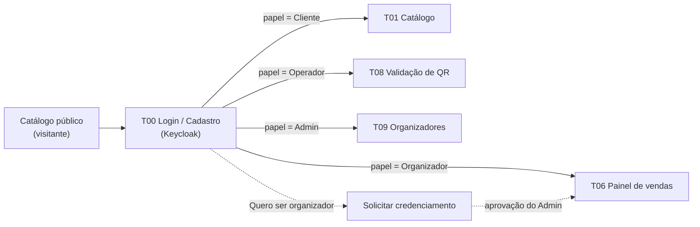

**Comprador**

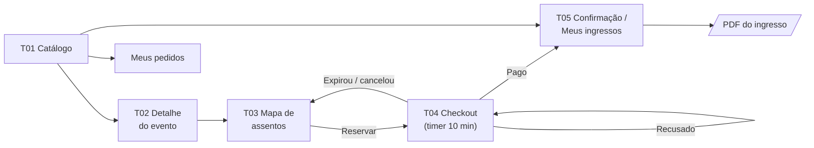

**Organizador**

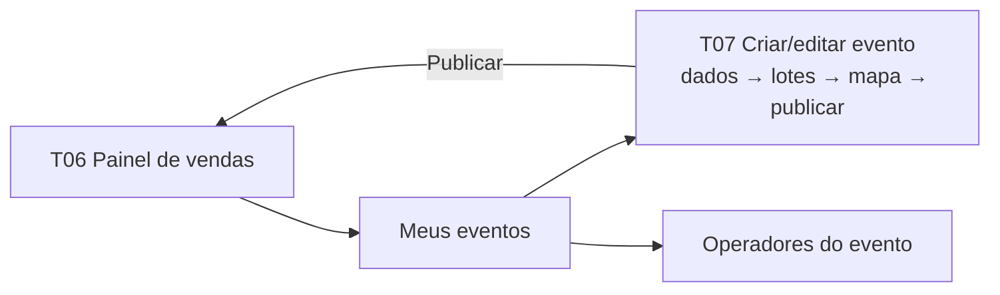

**Operador**

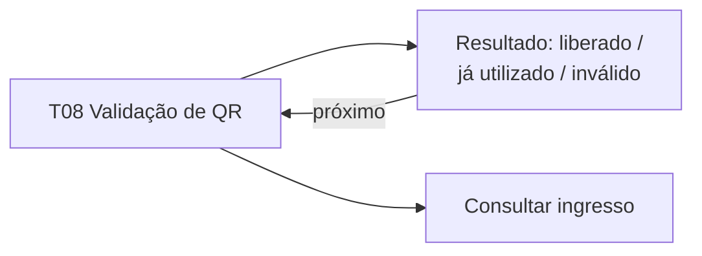

**Admin**

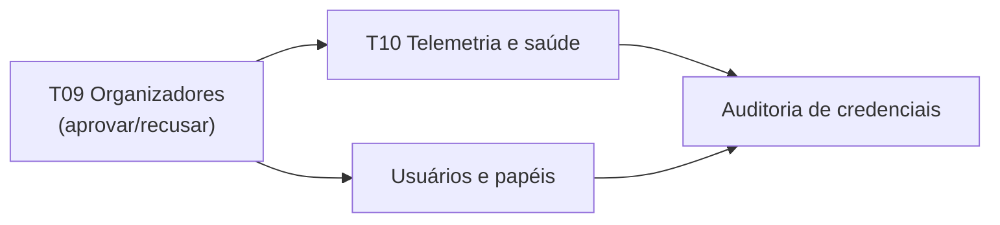

### 5.2.2 Fluxo crítico de compra (com estados do pedido)

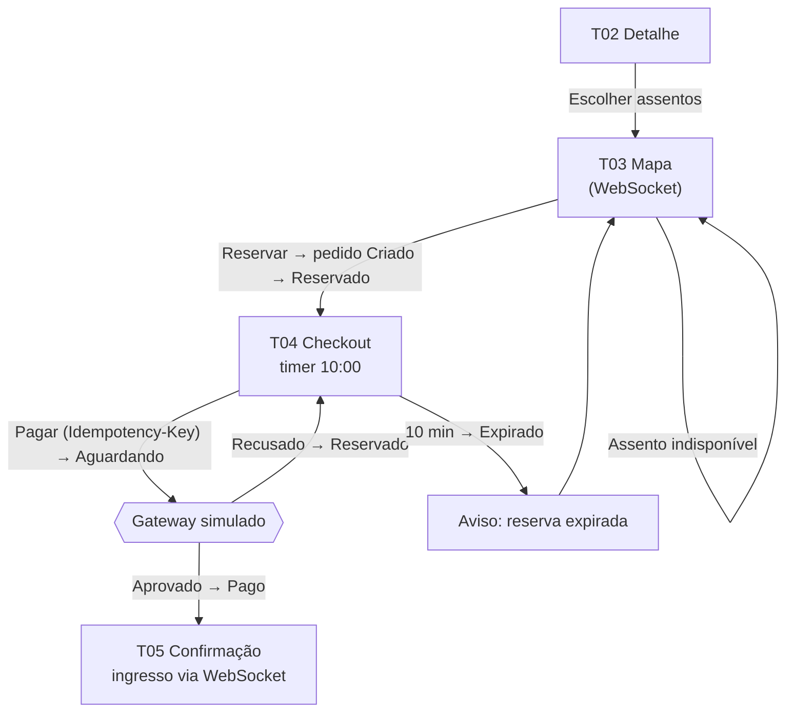

### 5.2.3 Rotas da SPA e papéis

| Tela | Rota | Papel exigido | Histórias |
|---|---|---|---|
| T00 Login / Cadastro | `/entrar`, `/cadastro` | público | US01, US02, US05 |
| T01 Catálogo | `/` , `/eventos?busca=` | público | US14, US16 |
| T02 Detalhe do evento | `/eventos/:id` | público | US15 |
| T03 Mapa de assentos | `/eventos/:id/assentos` | Cliente | US17, US18, US20 |
| T04 Checkout | `/pedidos/:id/pagamento` | Cliente | US19, US21, US22, US24 |
| T05 Meus ingressos | `/meus-ingressos` | Cliente | US25, US26, US28 |
| Meus pedidos | `/meus-pedidos` | Cliente | US21 |
| T06 Painel de vendas | `/organizador` | Organizador | US34 |
| T07 Criar/editar evento | `/organizador/eventos/:id/editar` | Organizador | US09–US13 |
| T08 Validação de QR | `/operador/validar` | Operador | US29, US30 |
| T09 Organizadores / usuários | `/admin/organizadores`, `/admin/usuarios` | Admin | US06, US07 |
| T10 Telemetria / auditoria | `/admin/telemetria`, `/admin/auditoria` | Admin | US08, US35 |

Acesso a rota sem o papel exigido → tela "Acesso negado" (HTTP 403); sem sessão → redireciona para `/entrar` e retorna à rota original após login.

## 5.3 Telas — Comprador

**T00 — Login** (compartilhada por todos os perfis; autenticação OIDC no Keycloak; estado de erro de credenciais). 
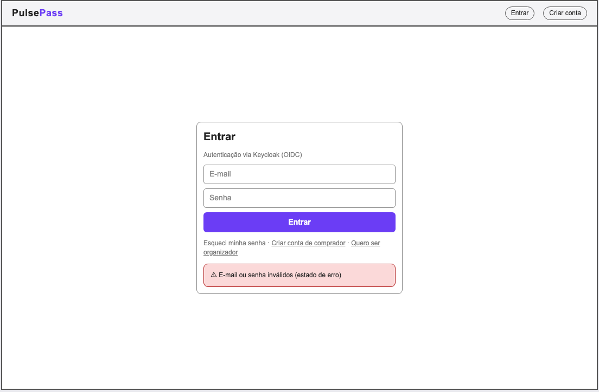

**T01 — Catálogo de eventos** (busca, filtros, indicadores "Esgotado"/"Últimos"/"Abre em"). 
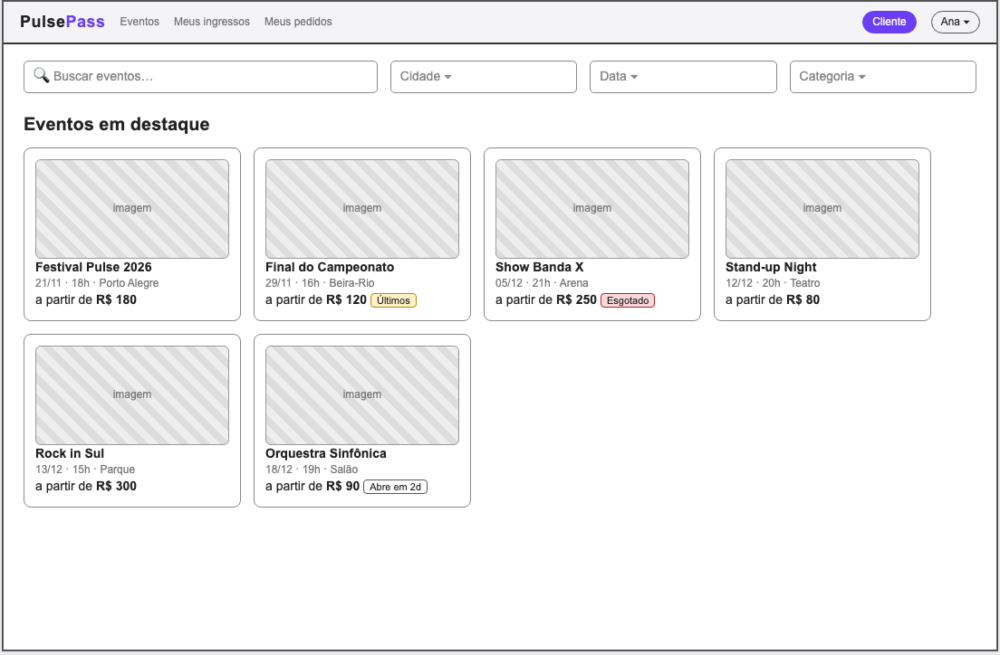

**T02 — Detalhe do evento** (lotes à venda, limite por pedido). 
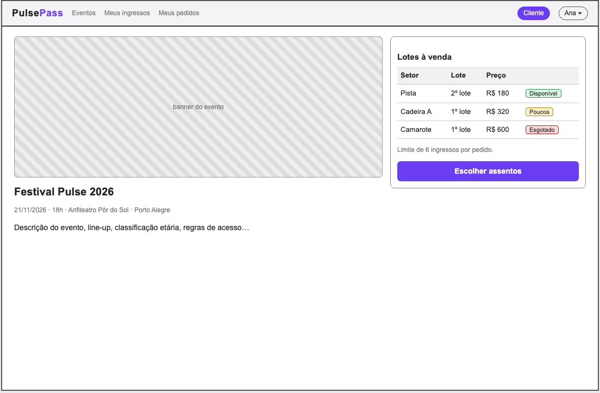

**T03 — Mapa de assentos** (legenda de status, seleção, aviso de bloqueio de 10 min, erro de assento disputado). 
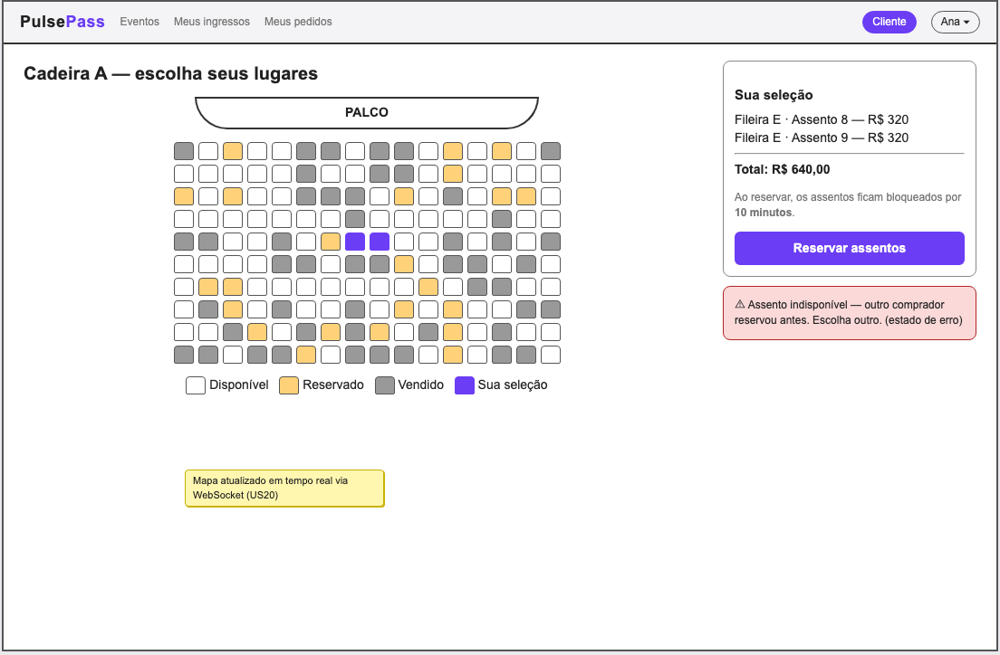

**T04 — Checkout** (contagem regressiva, status da FSM, botão com Idempotency-Key, estado de reserva expirada). 
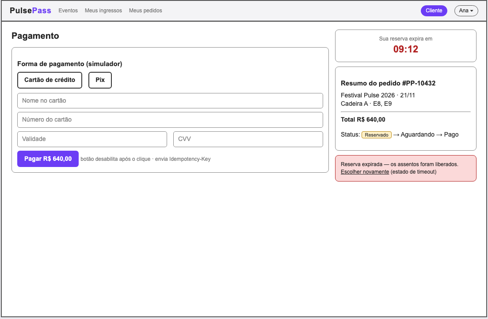

**T05 — Confirmação e Meus ingressos** (QR Code, carimbo de tempo, download do PDF, aviso em tempo real). 
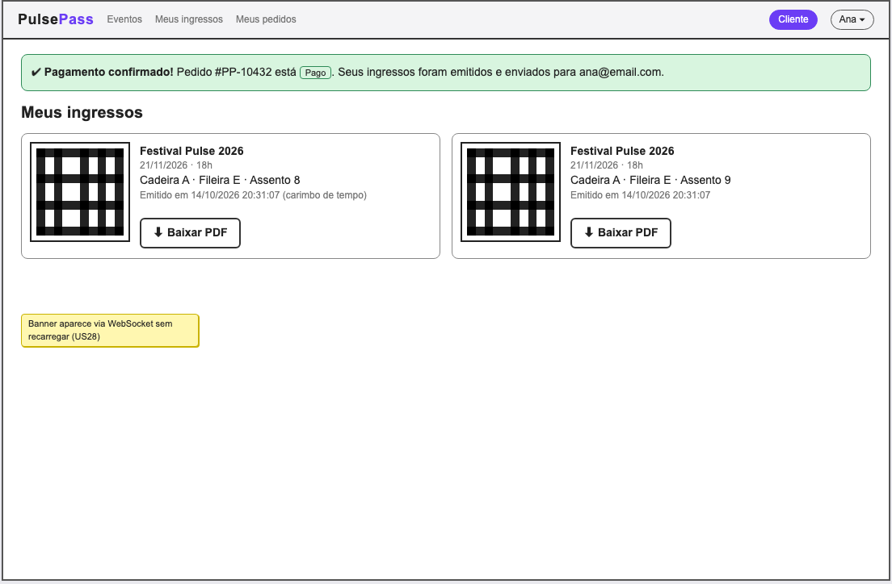

## 5.4 Telas — Organizador

**T06 — Painel de vendas em tempo real** (KPIs, vendas por minuto, lotes). 
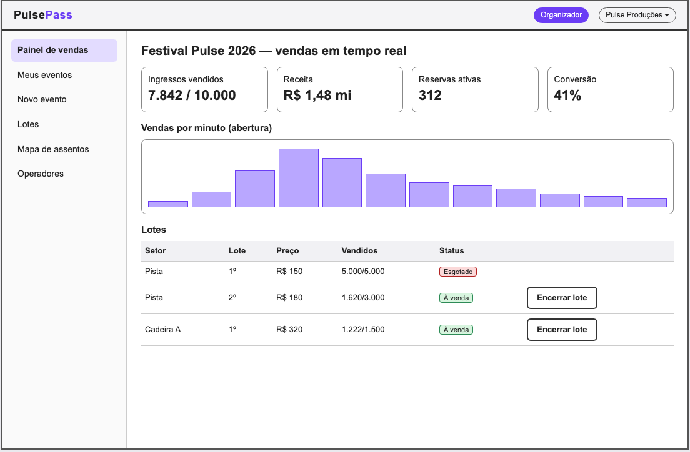

**T07 — Criar evento** (assistente: dados → lotes → mapa de assentos → publicar). 
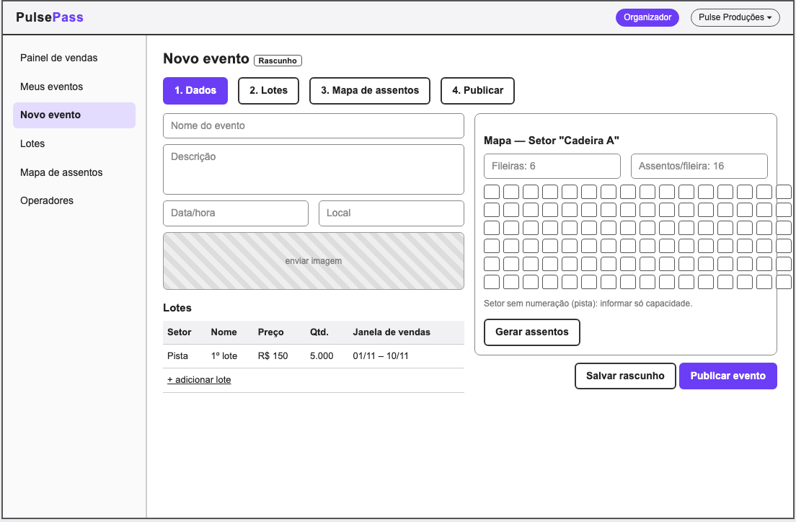

## 5.5 Telas — Operador

**T08 — Validação de acesso por QR Code** (câmera do navegador, entrada manual, três resultados possíveis). 
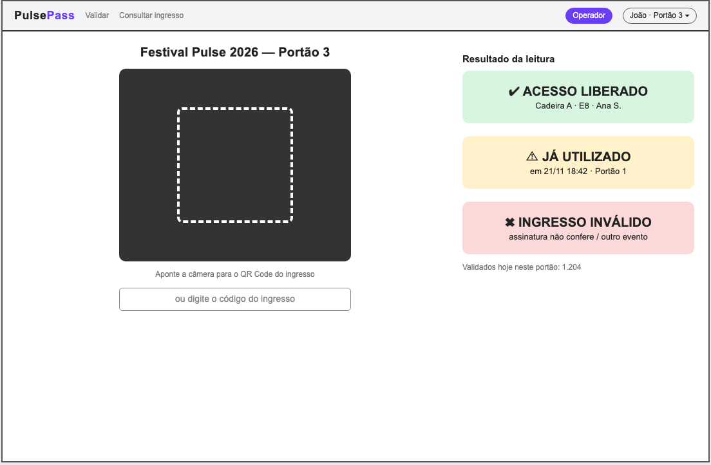

## 5.6 Telas — Admin

**T09 — Organizadores e usuários/papéis** (aprovação de credenciamento, RBAC, bloqueio). 
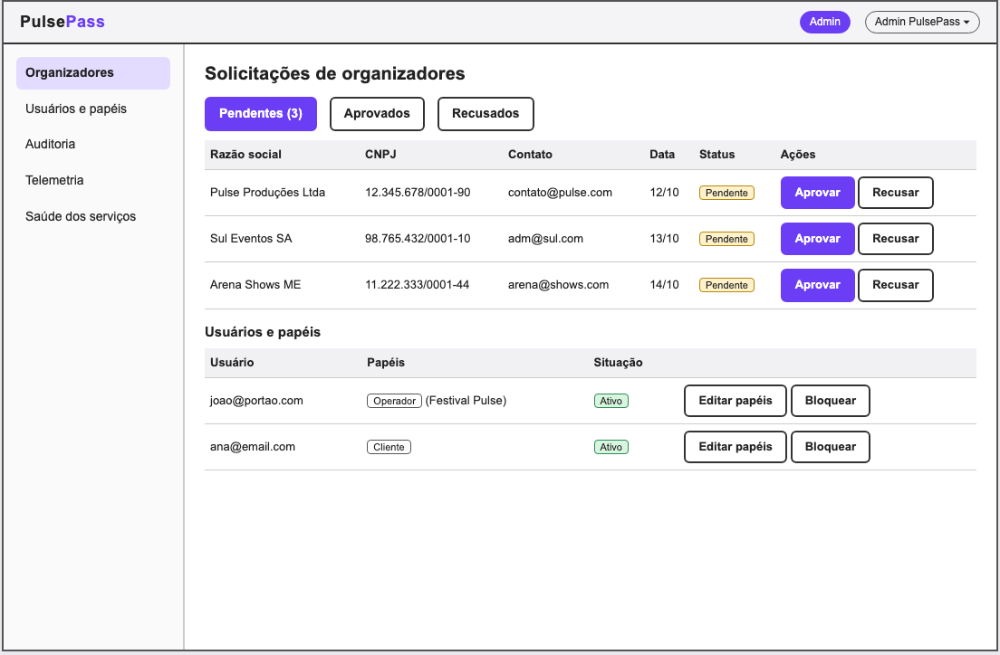

**T10 — Telemetria, saúde dos serviços e auditoria de credenciais.** 
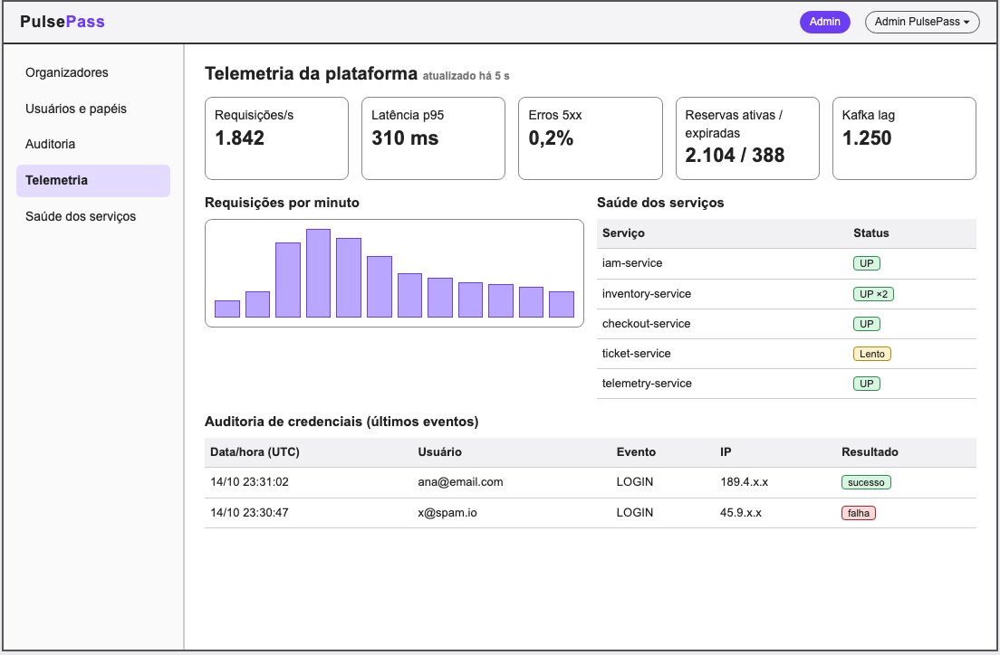
