# 1. Descrição da Arquitetura no Modelo C4

> Versão 1.0 · 04/11/2026 · Grupo 9 · Será atualizado nos Pacotes 3 e 4.
> Rótulos: **[Enunciado]** exigência do professor · **[Decisão do grupo, Pacote 1]** escolha já registrada · **[Proposta para revisão do grupo]** escolha nova deste pacote. As decisões novas estão detalhadas nos ADRs de `pacote-2/adr/`.
> Este documento descreve a arquitetura **planejada**. Nenhum serviço foi implementado até esta entrega.

## 1.1 Objetivo e leitura dos diagramas

O modelo C4 descreve o PulsePass em três níveis de zoom **[Enunciado]**:

| Nível | Pergunta que responde | Seção |
|---|---|---|
| C1 · Contexto | Quem usa o sistema e com quais sistemas externos ele conversa? | 1.2 |
| C2 · Contêineres | Quais processos implantáveis e bancos existem e como se comunicam? | 1.3 |
| C3 · Componentes | Como cada serviço de backend é organizado por dentro? | 1.4 |

Os diagramas são escritos em Mermaid (diagramas como código, versionados com o resto do projeto). Usamos sempre a mesma legenda:

| Forma / cor | Significa |
|---|---|
| Azul escuro | Pessoa (perfil RBAC) |
| Azul | Sistema PulsePass ou contêiner desenvolvido pelo grupo |
| Cinza | Sistema ou produto externo, não desenvolvido pelo grupo |
| Cilindro | Armazenamento de dados |
| Seta com rótulo | Finalidade da relação e protocolo |

Um **contêiner C4** é qualquer coisa que roda ou guarda dados separadamente (uma aplicação, um banco, um broker). Ele não é necessariamente um contêiner Docker, embora no PulsePass quase todos virem um serviço do `docker-compose.yml`.

## 1.2 Nível 1: Contexto

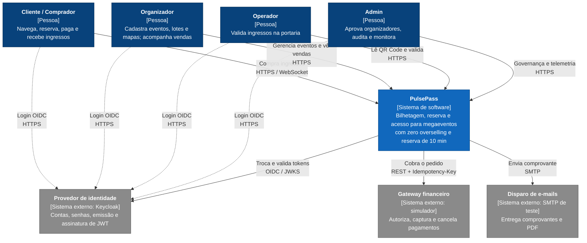

*Figura 1. C1: contexto do PulsePass. Escopo: o sistema inteiro e seus vizinhos.*

| Elemento | Tipo | Pertence ao PulsePass? | Observação |
|---|---|---|---|
| Cliente, Organizador, Operador, Admin | Pessoas | Não | Os quatro papéis RBAC **[Enunciado]** |
| PulsePass | Sistema | Sim | Desenvolvido pelo grupo |
| Provedor de identidade | Externo | Não | Keycloak, produto de terceiros executado localmente **[Decisão do grupo, Pacote 1 (R04)]** |
| Gateway financeiro | Externo | Não (simulado) | Representa um gateway bancário. O grupo escreve um simulador, mas ele fica fora da fronteira lógica do produto **[Decisão do grupo, Pacote 1 (P06)]** |
| Disparo de e-mails | Externo | Não | Em desenvolvimento, Mailpit; em produção seria um provedor SMTP |

## 1.3 Nível 2: Contêineres

O PulsePass adota o estilo arquitetural de **microsserviços** **[Enunciado]**: um serviço implantável por módulo do enunciado, cada um com seu próprio banco lógico, comunicação síncrona (REST) só onde a resposta é necessária na hora e assíncrona (Kafka) nos demais casos (ADR-001).

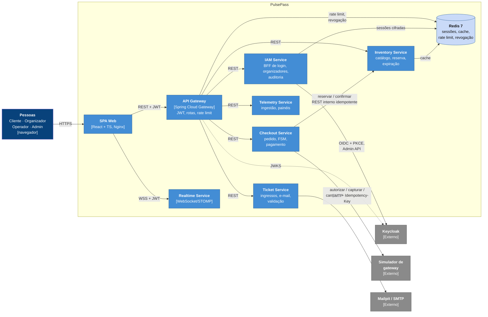

*Figura 2a. C2: contêineres e chamadas síncronas. Todos os contêineres de backend validam o JWT pela chave pública (JWKS) do Keycloak; só a seta do Gateway aparece para não poluir o diagrama.*

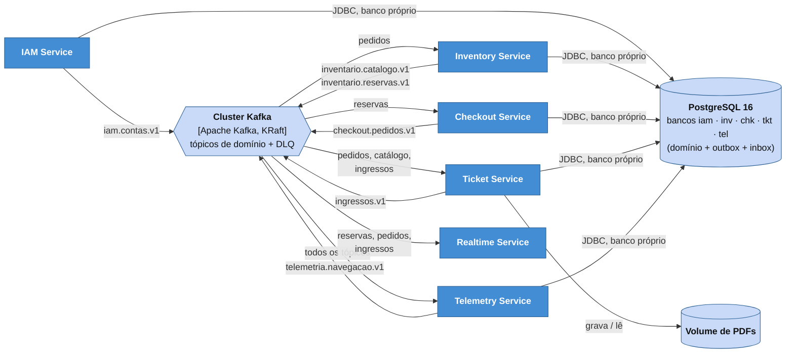

*Figura 2b. C2: dados e mensageria. Os serviços que publicam (à esquerda) usam a Outbox no próprio banco; os que consomem usam a Inbox (documento 3). Observabilidade e Kafka UI estão na Figura 3.*

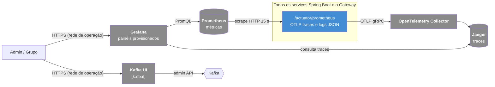

*Figura 3. C2 (complemento): contêineres de operação e observabilidade.*

### 1.3.1 Responsabilidade de cada contêiner

| Contêiner | Módulo do enunciado | Tecnologia | Responsabilidade | Dados que possui | Rótulo |
|---|---|---|---|---|---|
| SPA Web | Todos (front-end) | React + TS (Vite), servida por Nginx | Telas dos 4 perfis (Pacote 1, item 5); guarda só o access token em memória | Nenhum persistente | [Decisão do grupo, Pacote 1 (P02)] |
| API Gateway | Transversal | Spring Cloud Gateway | Ponto único de entrada HTTP; valida JWT; consulta lista de revogação; *rate limiting* por usuário/IP (RNF11); propaga `traceparent` | Contadores no Redis | [Decisão do grupo, Pacote 1] |
| IAM Service | 1. Identidade e Governança | Spring Boot 3, Java 21 | BFF de autenticação (login, refresh, logout), solicitação e aprovação de organizadores, gestão de papéis via Admin API do Keycloak, trilha de auditoria | Banco `iam`; sessões no Redis | [Proposta para revisão do grupo] (ADR-004) |
| Inventory Service | 2. Inventário e Concorrência | Spring Boot 3 | Eventos, setores, lotes, assentos, catálogo de alta leitura, reserva atômica, confirmação, devolução e expiração | Banco `inv`; cache no Redis | [Enunciado] + ADR-002 |
| Checkout Service | 3. Transações e Checkout | Spring Boot 3, Resilience4j | Pedido e FSM, Idempotency-Key, integração com simulador, Outbox, reconciliação | Banco `chk` | [Enunciado] + ADR-003 |
| Ticket Service | 4. Mensageria e Despacho | Spring Boot 3, OpenPDF, ZXing | Consome pagamentos, emite ingressos (PDF + QR assinado), envia e-mail, valida check-in | Banco `tkt`; volume de PDFs | [Enunciado] |
| Realtime Service | 4. Mensageria e Despacho | Spring Boot 3, STOMP | Mantém conexões WebSocket e empurra mudanças de assentos, pedidos e ingressos | Nenhum persistente | [Proposta para revisão do grupo] (ADR-001) |
| Telemetry Service | 5. Telemetria e DevOps | Spring Boot 3, Micrometer | Recebe eventos de navegação da SPA, consome eventos de domínio, agrega funil e vendas, expõe métricas de negócio | Banco `tel` | [Enunciado] |
| PostgreSQL | Infra | PostgreSQL 16 | Fonte da verdade de cada serviço, Outbox e Inbox | 5 bancos + banco `keycloak` | [Decisão do grupo, Pacote 1 (P03)] |
| Redis | Infra | Redis 7 (AOF ligado) | Sessões de refresh (cifradas), cache, *rate limit*, lista de revogação. **Não decide posse de assento** | Dados reconstruíveis, exceto sessões | [Proposta para revisão do grupo] (ADR-002, ADR-004) |
| Cluster Kafka | Infra | Apache Kafka 3.8 (KRaft) | Streaming de eventos de domínio. No Compose local o cluster tem 1 nó; o desenho de tópicos e produtores vale para 3 nós sem mudança de código (documento 3, seção 3.2) | Tópicos (documento 3) | [Enunciado] |
| Kafka UI | Infra | kafbat/kafka-ui | Inspeção de tópicos, grupos, lag e DLQ | Nenhum | [Decisão do grupo, Pacote 1 (P04)] |
| Simulador de gateway | Externo | Spring Boot (código do grupo) | Autorizar, capturar, cancelar; modos de falha e atraso configuráveis | Banco em memória | [Decisão do grupo, Pacote 1 (P06)] |

### 1.3.2 Protocolos e fronteiras de confiança

| Fronteira | De → Para | Protocolo | Autenticação | Observação |
|---|---|---|---|---|
| Internet → borda | Navegador → SPA, Gateway, Realtime | HTTPS / WSS (TLS no Nginx de borda) | JWT Bearer; cookie de sessão `HttpOnly` só no `/auth/*` | Única fronteira exposta (RNF23) |
| Borda → serviços | Gateway → serviços | HTTP na rede Docker interna `backend` | JWT repassado; cada serviço revalida assinatura, `exp`, `aud` e papel (RNF18) | Serviços não publicam portas para fora no Compose |
| Serviço → serviço | Checkout → Inventory | HTTP interno | Token de *client credentials* do Keycloak (conta de serviço `checkout`, escopo `inventario.reservas`) | Endpoints `/internal/*` não passam pelo Gateway |
| Serviço → externo | Checkout → simulador; Ticket → SMTP | HTTP / SMTP | Chave de API do simulador via variável de ambiente | Nunca enviar dados de cartão reais (são simulados) |
| Serviço → infraestrutura | Serviços → PostgreSQL, Redis, Kafka | JDBC, RESP, Kafka | Usuário e senha por serviço (variáveis de ambiente, `.env` fora do Git); ACL Redis por prefixo | Usuário de banco só enxerga o próprio banco (ADR-001) |
| Operação | Grupo → Grafana, Kafka UI, Jaeger | HTTP em rede `ops` | Login do Grafana; Kafka UI só em ambiente local | Não expostos no ambiente de demonstração pública |

### 1.3.3 Principais APIs expostas pelo Gateway

| Serviço | Endpoints (resumo) | Papel exigido |
|---|---|---|
| IAM | `GET /auth/login`, `GET /auth/callback`, `POST /auth/refresh`, `POST /auth/logout`, `POST /organizadores/solicitacoes`, `PATCH /admin/organizadores/{id}`, `PUT /admin/usuarios/{id}/papeis`, `GET /admin/auditoria` | público / autenticado / admin |
| Inventory | `GET /eventos`, `GET /eventos/{id}`, `GET /eventos/{id}/setores/{s}/assentos`, `POST /organizador/eventos`, `POST /organizador/eventos/{id}/lotes`, `PUT .../mapa`, `POST .../publicacao`, `PUT /organizador/eventos/{id}/operadores` | público / organizador dono |
| Checkout | `POST /pedidos` (com `Idempotency-Key`), `GET /pedidos/{id}`, `POST /pedidos/{id}/pagamento` (com `Idempotency-Key`), `POST /pedidos/{id}/cancelamento` | cliente dono |
| Ticket | `GET /ingressos`, `GET /ingressos/{id}/pdf`, `POST /validacoes`, `GET /operador/ingressos?codigo=` | cliente dono / operador vinculado |
| Telemetry | `POST /telemetria/eventos` (lote), `GET /organizador/eventos/{id}/painel`, `GET /admin/painel` | autenticado / organizador dono / admin |

Os contratos detalhados serão gerados em OpenAPI 3 no build de cada serviço (RNF36) a partir do Pacote 3.

## 1.4 Nível 3: Componentes

Todos os serviços seguem **arquitetura hexagonal** **[Decisão do grupo, Pacote 1 (RNF34)]**: adaptadores de entrada (controllers, consumidores) → casos de uso (camada de aplicação) → domínio puro (sem Spring, JPA ou Kafka) → portas implementadas por adaptadores de saída. ArchUnit verifica essas dependências. Os diagramas abaixo mostram os componentes principais; a ordem de prioridade é Inventário, Checkout e Ingressos, que concentram os requisitos de concorrência e consistência.

### 1.4.1 Inventory Service

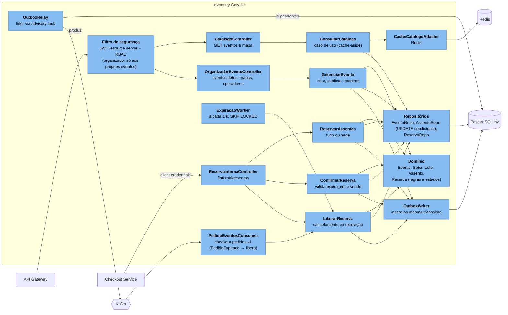

*Figura 4. C3: componentes do Inventory Service.*

| Componente | Responsabilidade | Regra crítica |
|---|---|---|
| `ReservarAssentos` | Recebe `pedidoId`, `eventoId` e 1 a 6 assentos; abre transação; executa o `UPDATE` condicional em ordem de `id`; cria `Reserva` com `expira_em`; grava `ReservaCriada` na Outbox | Linhas afetadas = assentos pedidos, senão *rollback* (RNF01, RNF02, ADR-002). Os **locks concorrentes** exigidos pelo enunciado são os bloqueios de linha que esse `UPDATE` obtém no PostgreSQL, sempre na mesma ordem para evitar *deadlock*. Idempotente por `pedidoId` |
| `ConfirmarReserva` | Chamado pelo Checkout após autorização do pagamento | Só confirma se `estado='ATIVA' AND now() < expira_em`; marca assentos `VENDIDO` (ADR-003) |
| `LiberarReserva` | Cancelamento pelo comprador, falha de pagamento definitiva ou expiração | Devolve todos os assentos da reserva na mesma transação; grava `ReservaExpirada` ou `ReservaLiberada` |
| `ExpiracaoWorker` | Varre reservas vencidas | Várias réplicas podem rodar: `FOR UPDATE SKIP LOCKED` impede duas limpezas da mesma reserva |
| `ConsultarCatalogo` | Leitura de alto volume | *Cache-aside* com TTL de 30 s para catálogo; mapa de assentos com TTL de 2 s e invalidação por evento; o banco continua sendo a verdade |
| `OutboxRelay` | Publica eventos pendentes | Um relay ativo por serviço, em ordem de `id` (ADR-005) |

### 1.4.2 Checkout Service

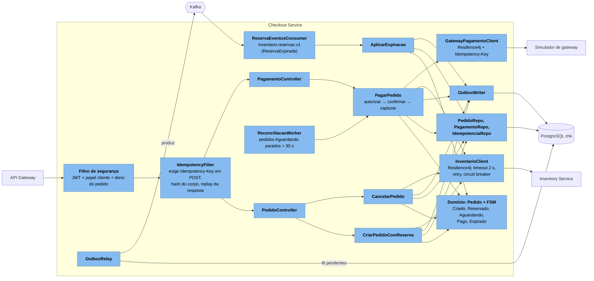

*Figura 5. C3: componentes do Checkout Service.*

| Componente | Responsabilidade | Regra crítica |
|---|---|---|
| `IdempotencyFilter` | Antes do controller: valida presença da chave (400 se ausente, RNF05), grava registro `EM_ANDAMENTO` com hash SHA-256 do método, rota e corpo | Detalhes na seção 1.5.4 |
| `CriarPedidoComReserva` | Cria pedido `Criado`, chama `ReservarAssentos` no Inventário, avança para `Reservado` com `expiraEm` copiado da reserva | Falha da reserva leva a `Expirado` com motivo `FALHA_RESERVA` |
| `PagarPedido` | `Reservado → Aguardando`, autoriza no simulador, confirma no Inventário, captura, `Aguardando → Pago` + `PagamentoConfirmado` na Outbox | Ordem e compensação do ADR-003 |
| `AplicarExpiracao` | Consome `ReservaExpirada` e leva pedido não pago a `Expirado` | Transição guardada: evento sobre pedido `Pago` é ignorado e registrado (US21) |
| `ReconciliacaoWorker` | Resolve pedidos `Aguardando` após timeouts consultando o simulador e o Inventário | Nunca cria nova cobrança: usa sempre o mesmo `pagamentoId` |
| Domínio FSM | Puro Java, sem framework | Cobertura ≥ 90% de ramos, PIT ≥ 70% (RNF04, RNF32) |

### 1.4.3 Ticket Service e Realtime Service

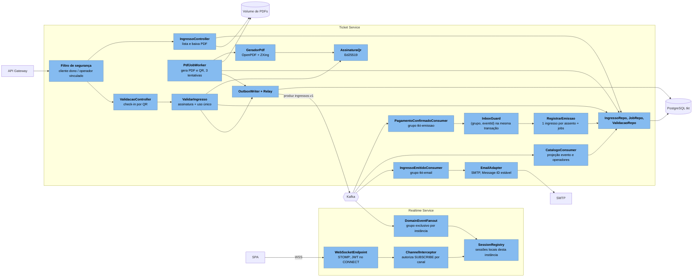

*Figura 6. C3: componentes do Ticket Service e do Realtime Service.*

| Componente | Responsabilidade | Regra crítica |
|---|---|---|
| `PagamentoConfirmadoConsumer` + `InboxGuard` + `RegistrarEmissao` | Em uma transação: grava `(tkt-emissao, eventId)`, cria um ingresso `PENDENTE` por item de pedido e um job de PDF por ingresso | `UNIQUE (item_pedido_id)` garante um ingresso por assento mesmo com reprocessamento (RNF07) |
| `PdfJobWorker` | Gera o PDF (evento, setor, assento, titular, carimbo de tempo, QR assinado), grava em `ingressos/{ingressoId}.pdf`, marca `EMITIDO` e grava `IngressoEmitido` na Outbox | Mesmo `ingressoId` sobrescreve o mesmo arquivo; após 3 falhas o job vai a `FALHOU` e gera alerta (US25) |
| `ValidarIngresso` | Verifica assinatura, evento e vínculo do operador; `UPDATE ingresso SET estado='UTILIZADO' WHERE id=? AND estado='EMITIDO'` | Linha afetada = liberado; zero linhas = "já utilizado" ou inválido (RNF22, US29) |
| `IngressoEmitidoConsumer` + `EmailAdapter` | Envia e-mail com PDF anexado | Registra `NOTIFICACAO` como PENDENTE antes do SMTP e ENVIADA depois; limite de idempotência no documento 3, seção 3.7. O **disparo multicanal** passa por uma porta `CanalNotificacao`: e-mail (este adaptador) e tela (Realtime, WebSocket) no escopo atual; SMS e push entram como novos adaptadores sem mudar o caso de uso (US27) |
| `DomainEventFanout` | Cada instância do Realtime usa um consumer group próprio (`rt-{instanceId}`), lendo do fim do tópico | Todas as instâncias recebem todos os eventos e entregam só às suas sessões (seção 1.6) |

### 1.4.4 IAM Service

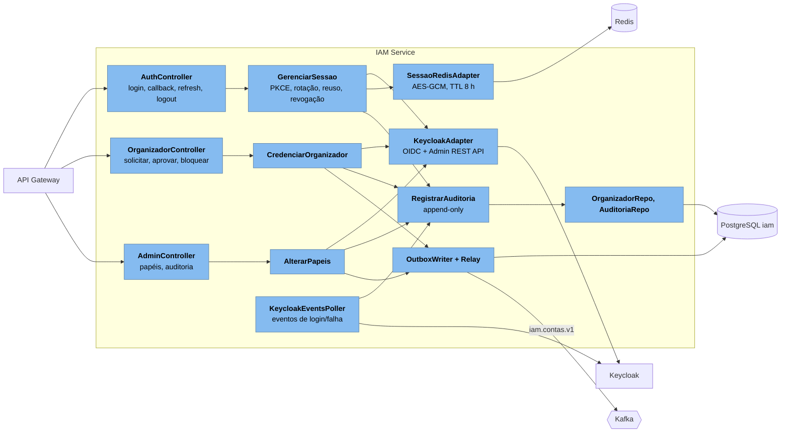

*Figura 7. C3: componentes do IAM Service (ADR-004).*

### 1.4.5 Telemetry Service

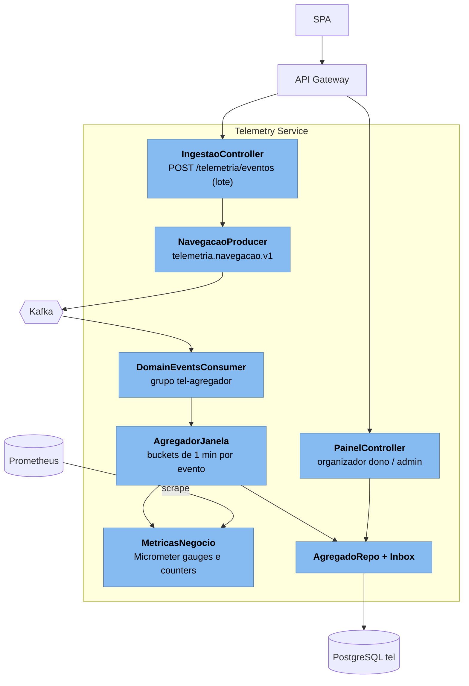

*Figura 8. C3: componentes do Telemetry Service.*

O Telemetry Service consome os tópicos de domínio e o de navegação no grupo `tel-agregador`, separado dos grupos de Checkout e Ingressos, de modo que todos recebem os mesmos eventos sem competir (documento 3). O painel do organizador filtra pelos eventos do organizador usando a projeção `evento → organizador` recebida de `inventario.catalogo.v1`.

## 1.5 Fluxos críticos (diagramas de sequência)

### 1.5.1 Reserva concorrente do mesmo assento

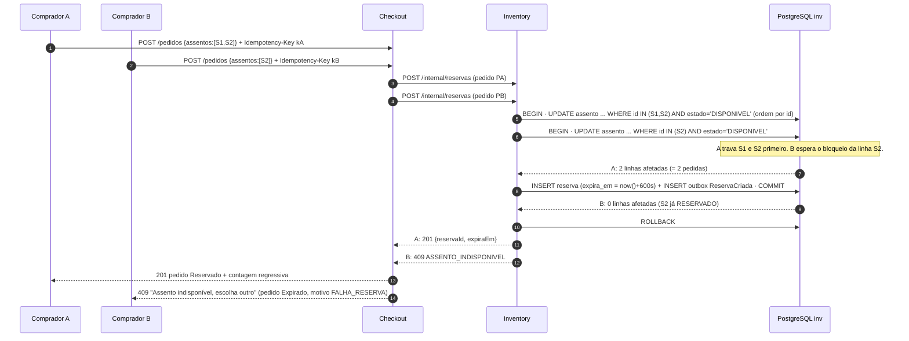

*Figura 9. Dois compradores disputando S2. Com 1.000 compradores o comportamento é o mesmo: uma única transação vence (RNF01, US18).*

### 1.5.2 Pagamento, Outbox, Kafka e emissão do ingresso

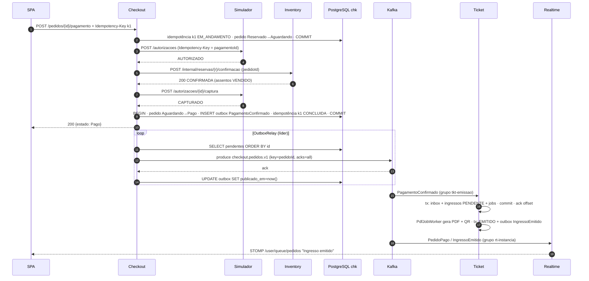

*Figura 10. Caminho feliz do pagamento até o aviso em tempo real (US22, US23, US25, US28, RNF12).*

### 1.5.3 Expiração concorrendo com a confirmação

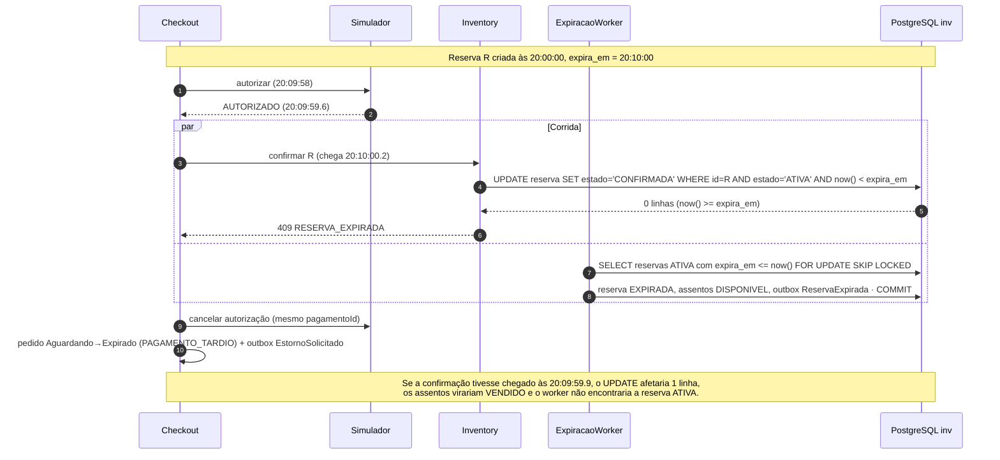

*Figura 11. A linha condicional no banco do Inventário decide sozinha quem vence. Pagamento tardio nunca volta para Pago (ADR-003, US19, US21).*

### 1.5.4 Repetição HTTP e recuperação após falha do broker

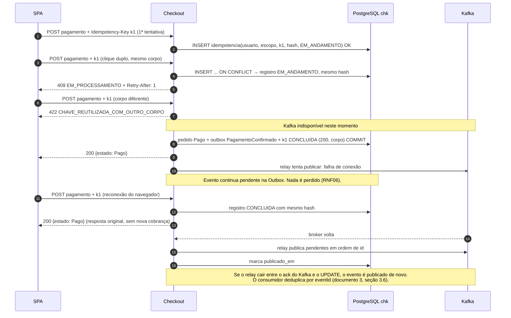

*Figura 12. Idempotency-Key e Outbox sob repetição e falha do broker (RNF05, RNF06, RNF07, US22, US23).*

**Regras da Idempotency-Key** **[Proposta para revisão do grupo]**, detalhando RNF05 e US22:

| Situação | Resposta |
|---|---|
| POST de escrita sem `Idempotency-Key` | 400 |
| Chave nova | Processa; registro passa de `EM_ANDAMENTO` para `CONCLUIDA` guardando status HTTP e corpo |
| Mesma chave, mesmo hash, `CONCLUIDA` | Devolve a resposta guardada, sem novo efeito |
| Mesma chave, mesmo hash, `EM_ANDAMENTO` | 409 com `Retry-After: 1` (não executa em paralelo) |
| Mesma chave, hash diferente | 422 (definido na US22) |
| `EM_ANDAMENTO` há mais de 30 s (processo caiu) | Não reexecuta às cegas: o pedido é reconciliado pelo estado atual na FSM e no simulador, e a resposta é derivada desse estado |

Escopo da chave: `(usuarioId, metodo + rota, chave)`; duas pessoas podem usar o mesmo UUID sem colisão. Retenção: 24 h (RNF05), removida por job diário.

## 1.6 Tempo real: caminho WebSocket e controle de canais

| Aspecto | Desenho **[Proposta para revisão do grupo]** |
|---|---|
| Conexão | SPA abre `wss://.../ws` no Realtime Service; o *frame* STOMP `CONNECT` leva o access token; o `ChannelInterceptor` valida assinatura, `exp` e papéis |
| Canais | `/topic/eventos/{eventoId}/assentos` (mapa de assentos, qualquer usuário autenticado); `/user/queue/pedidos` (pedidos e ingressos do próprio usuário, destino resolvido pelo `sub` do token); `/topic/organizador/eventos/{eventoId}/vendas` (só o organizador dono, verificado na projeção de eventos) |
| Autorização | Cada `SUBSCRIBE` é checado. Um cliente não consegue assinar a fila de outro usuário porque o destino `/user/...` é sempre resolvido pelo servidor a partir do token |
| Fonte das mensagens | O Realtime não recebe chamadas dos serviços: ele consome `inventario.reservas.v1`, `checkout.pedidos.v1` e `ingressos.v1` e traduz para mensagens de tela |
| Múltiplas instâncias | Cada instância entra em um **consumer group exclusivo** (`rt-{instanceId}`) com `auto.offset.reset=latest`; todas recebem todos os eventos e cada uma entrega apenas às sessões conectadas nela. Não há estado compartilhado entre instâncias |
| Reconexão | O cliente reconecta em até 5 s (RNF29) e, ao reconectar, busca o estado atual por REST (`GET /pedidos/{id}`, mapa de assentos). O WebSocket é otimização; a fonte de verdade continua sendo a API |
| Expiração do token | Sessão WebSocket é encerrada quando o access token vence; a SPA renova pelo `/auth/refresh` e reconecta |

## 1.7 Segurança transversal

| Tema | Decisão |
|---|---|
| Tokens | Access token JWT RS256 do Keycloak, validade ≤ 5 min, validado pelo JWKS em cada contêiner (RNF18). É assim que o Inventário e os demais módulos "validam a identidade com o IAM" [Enunciado]: o módulo IAM é o conjunto IAM Service + Keycloak, e a assinatura criptográfica dos tokens vale para todas as rotas |
| Sessão | Refresh token do Keycloak guardado cifrado no Redis pelo IAM; SPA recebe identificador opaco em cookie `HttpOnly` (ADR-004, RNF19) |
| RBAC | Papéis no realm; anotações `@PreAuthorize` em todo controller e checagem de dono do recurso (organizador do evento, cliente do pedido, operador vinculado) (RNF20) |
| Auditoria | Eventos de credencial gravados *append-only* no banco `iam` (permissão só de `INSERT` e `SELECT` para o usuário da aplicação) (RNF21) |
| Ingresso | QR com `ingressoId`, `eventoId` e assinatura Ed25519; chave privada só no Ticket Service via variável de ambiente (RNF22) |
| Segredos | Nada versionado; `.env.example` sem valores reais; gitleaks no CI (RNF23) |
| Logs | JSON com `traceId`; filtro mascara `Authorization`, cookies e chaves (RNF27) |

## 1.8 Rastreabilidade

| Requisito | Onde é atendido neste documento |
|---|---|
| US18, US19, RNF01, RNF02, RNF03 | 1.4.1, Figuras 9 e 11, ADR-002 |
| US21, US22, US23, US24, RNF04, RNF05, RNF06, RNF15 | 1.4.2, Figuras 10 a 12, seção 1.5.4, ADR-003 |
| US25, US28, US29, RNF07, RNF08, RNF12, RNF22, RNF29 | 1.4.3, Figura 10, seção 1.6 |
| RNF18 a RNF21, RNF23 | 1.3.2, 1.4.4, 1.7, ADR-004 |
| RNF25, RNF26, RNF28 | Figura 3, 1.4.5 |
| RNF34 | Introdução da seção 1.4 (hexagonal + ArchUnit), ADR-001 |
| RNF37 a RNF40, US32, US33 | Contêineres em 1.3; detalhes no documento 4 |
