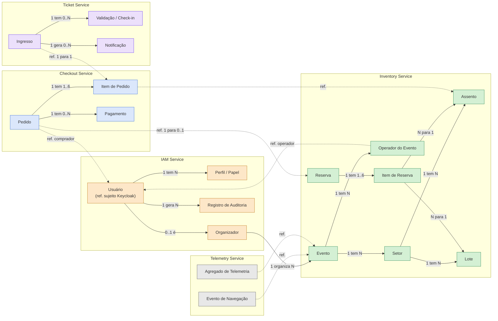
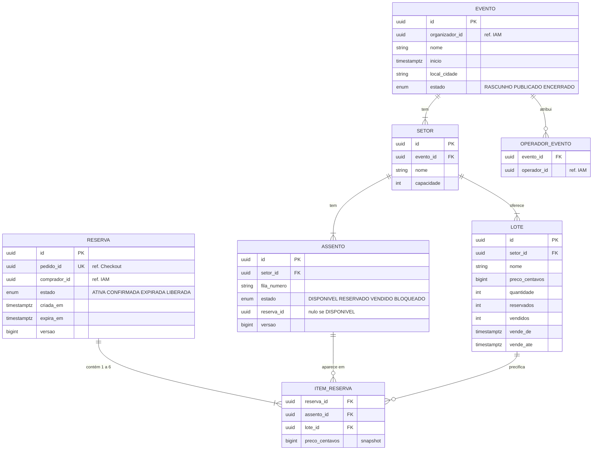
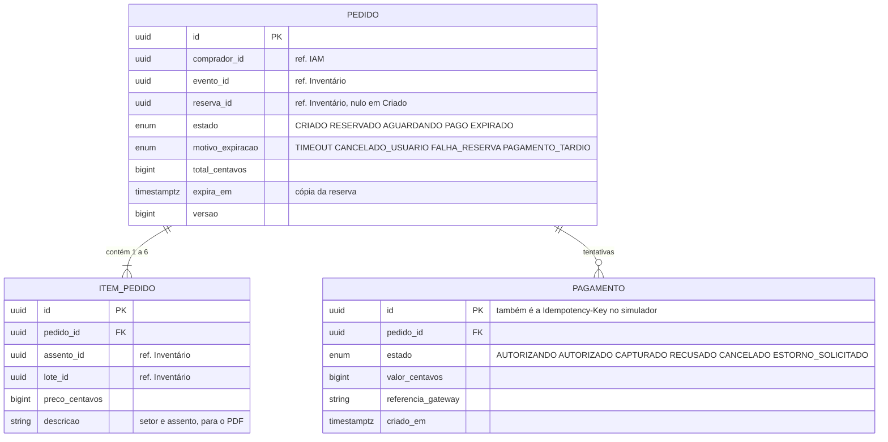
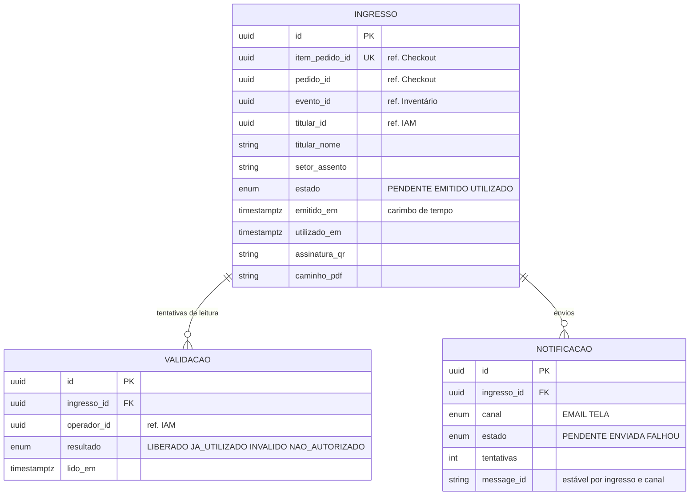
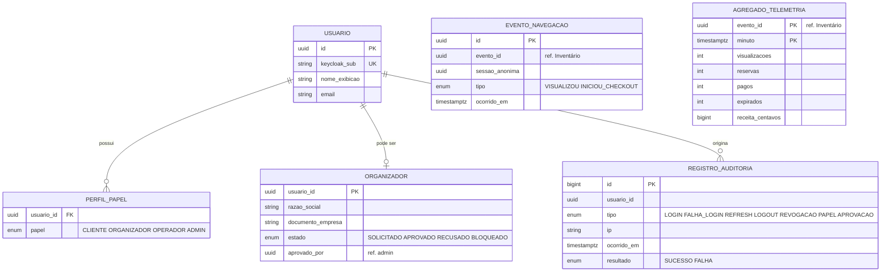
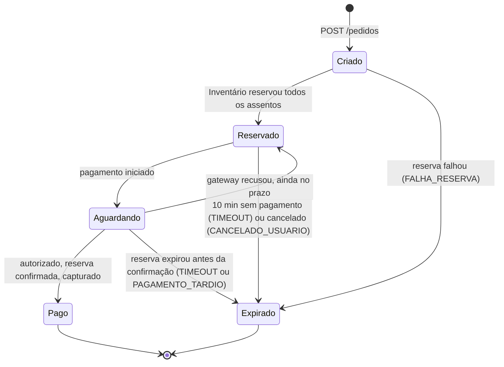

# 2. Descrição do Modelo de Dados Conceitual

> Versão 1.0 · 04/11/2026 · Grupo 9 · Será atualizado nos Pacotes 3 e 4.
> Rótulos: **[Enunciado]** · **[Decisão do grupo, Pacote 1]** · **[Decisão do grupo, Pacote 2]** (escolha nova, aprovada pelo grupo em 04/11/2026 com os ADRs) · **[Proposta para revisão do grupo]** (detalhe ainda não revisado pelo grupo).
> Modelo **conceitual**: mostra conceitos do negócio, relacionamentos, cardinalidades e regras. Tipos físicos, índices e migrações serão definidos com o código (Pacote 3).

## 2.1 Princípios

1. **Cada entidade tem um único serviço dono** **[Decisão do grupo, Pacote 1 (P03, RNF34)]**. Só o dono grava; os outros recebem cópias (projeções) por eventos ou consultam a API.
2. **Referências entre serviços são identificadores**, não chaves estrangeiras. No diagrama, linhas que cruzam serviços estão marcadas como "ref." e não implicam *join* nem FK entre bancos (ADR-001).
3. Identificadores são UUID (v7, ordenáveis por tempo), gerados pelo dono.
4. Instantes são gravados em **UTC** (`timestamptz`); a SPA apresenta em pt-BR, fuso America/Sao_Paulo (RNF44).
5. Valores monetários em **centavos inteiros** (`BIGINT`) com moeda `BRL`; nunca ponto flutuante.
6. Dados pessoais mínimos (LGPD, RNF23): senha só no Keycloak; o PulsePass guarda `sub` do Keycloak, nome de exibição e e-mail; CPF só se o titular do ingresso precisar dele na portaria (US30).

## 2.2 Visão geral das entidades e donos

*Figura 13. Entidades por serviço dono. Linhas contínuas: relacionamento dentro do mesmo banco. Linhas tracejadas "ref.": referência por identificador entre serviços.*

## 2.3 Modelo por serviço (cardinalidades e atributos relevantes)

### 2.3.1 Inventory Service (banco `inv`)

*Figura 14. Inventário: catálogo, mapa, lotes e reservas.*

**Lote × assento** **[Proposta para revisão do grupo]**: o enunciado pede "criação de lotes e mapas de assentos" sem dizer como se relacionam. Propomos que **um lote pertença a um setor** e define preço, quantidade e janela de vendas. Um assento não é amarrado a um lote fixo: na reserva, o assento recebe o preço do **lote ativo do seu setor** naquele instante, e o `ITEM_RESERVA` guarda o lote e o preço (*snapshot*). Isso permite "1º lote, 2º lote" no mesmo setor sem recadastrar o mapa. A quantidade do lote é respeitada na mesma transação da reserva (`UPDATE lote SET reservados = reservados + n WHERE id = ? AND reservados + vendidos + n <= quantidade`).

**Operador do evento**: entidade adicional, necessária porque a US29 exige que o operador só valide eventos aos quais foi vinculado. Fica no Inventário porque é o organizador dono do evento quem atribui operadores.

### 2.3.2 Checkout Service (banco `chk`)

*Figura 15. Checkout: pedido, itens e tentativas de pagamento.*

O pedido tem **0..N pagamentos** porque, pela US24, uma recusa devolve o pedido a Reservado e o comprador pode tentar de novo dentro do prazo. No máximo um pagamento pode estar `AUTORIZADO` ou `CAPTURADO` por pedido (unicidade parcial). Nenhum dado de cartão é guardado (os dados são simulados).

### 2.3.3 Ticket Service (banco `tkt`)

*Figura 16. Ingressos: emissão, validação e notificações.*

### 2.3.4 IAM Service (banco `iam`) e Telemetry Service (banco `tel`)

*Figura 17. IAM e Telemetria. Os papéis vivem no Keycloak; `PERFIL_PAPEL` é cópia para consulta e auditoria, atualizada pelo IAM quando ele altera papéis via Admin API.*

## 2.4 Máquina de estados do pedido

A FSM é **exigida pelo enunciado** com os cinco estados Criado, Reservado, Aguardando, Pago e Expirado. As transições abaixo são as do Pacote 1 (US21, US24); este pacote só acrescenta as pré-condições e efeitos. **Nenhum estado novo foi criado**: cancelamento, recusa definitiva e pagamento tardio são **motivos** de `Expirado`, não estados.

*Figura 18. FSM do pedido [Enunciado + Decisão do grupo, Pacote 1 (US21, US24)].*

| De | Para | Gatilho | Pré-condição | Efeitos na mesma transação |
|---|---|---|---|---|
| - | Criado | `POST /pedidos` com Idempotency-Key | 1 a 6 assentos, evento publicado, lote em janela de vendas | Insere pedido e itens; registro de idempotência |
| Criado | Reservado | Resposta 201 do Inventário | `reservaId` e `expiraEm` recebidos | Grava `reserva_id`, `expira_em`; Outbox `PedidoReservado` |
| Criado | Expirado | 409 ou falha definitiva do Inventário | - | Motivo `FALHA_RESERVA`; Outbox `PedidoExpirado` |
| Reservado | Aguardando | `POST /pedidos/{id}/pagamento` | `now() < expira_em` (checagem local, o Inventário confirma depois) | Cria `PAGAMENTO` `AUTORIZANDO`; Outbox `PagamentoIniciado` |
| Reservado | Expirado | `ReservaExpirada` consumido ou cancelamento | Pedido não está Pago | Motivo `TIMEOUT` ou `CANCELADO_USUARIO`; Outbox `PedidoExpirado` |
| Aguardando | Pago | Autorização + confirmação no Inventário + captura | Inventário respondeu 200 (ADR-003) | Pagamento `CAPTURADO`; Outbox `PagamentoConfirmado` |
| Aguardando | Reservado | Simulador recusou | Reserva ainda válida | Pagamento `RECUSADO`; Outbox `PagamentoRecusado`; prazo original mantido (US24) |
| Aguardando | Expirado | Inventário respondeu 409 `RESERVA_EXPIRADA` ou `ReservaExpirada` consumido | Pedido não está Pago | Cancela autorização; pagamento `CANCELADO` ou `ESTORNO_SOLICITADO`; motivo `PAGAMENTO_TARDIO` se havia autorização; Outbox `PedidoExpirado` e, se for o caso, `EstornoSolicitado` |
| Pago, Expirado | qualquer | qualquer evento | - | **Rejeitado**, registrado em log e métrica `fsm_transicao_invalida_total` (RNF04) |

Toda transição é feita por `UPDATE pedido SET estado = :novo, versao = versao + 1 WHERE id = :id AND estado = :esperado`: se outra transação mudou o estado antes, zero linhas são afetadas e a transição não acontece. Isso torna seguras as corridas entre o consumidor de expiração e o fluxo de pagamento.

## 2.5 Estados auxiliares (não fazem parte da FSM do pedido)

| Entidade | Estados | Por que existem |
|---|---|---|
| Reserva (Inventário) | ATIVA → CONFIRMADA · ATIVA → EXPIRADA · ATIVA → LIBERADA | A reserva tem vida própria no Inventário; é o que o ADR-003 usa como ponto de decisão |
| Assento | DISPONIVEL ⇄ RESERVADO → VENDIDO; BLOQUEADO (fora de venda, definido pelo organizador) | Mapa de assentos e garantia de zero overselling |
| Pagamento | AUTORIZANDO → AUTORIZADO → CAPTURADO; → RECUSADO; AUTORIZADO → CANCELADO; CAPTURADO → ESTORNO_SOLICITADO | Duas fases do simulador (ADR-003) |
| Ingresso | PENDENTE → EMITIDO → UTILIZADO | PDF é gerado de forma assíncrona; uso único (US29) |

## 2.6 Invariantes e como cada uma é garantida

| # | Invariante | Garantia | Requisito |
|---|---|---|---|
| I1 | Um assento tem no máximo uma reserva ATIVA ou CONFIRMADA | `UPDATE` condicional `estado='DISPONIVEL'` + `assento.reserva_id` único enquanto não DISPONIVEL; decisão só no PostgreSQL (ADR-002) | RNF01 |
| I2 | Reserva com vários assentos é tudo ou nada | Uma transação; linhas afetadas = assentos pedidos, senão *rollback* | RNF02 |
| I3 | Reserva só é confirmada antes de `expira_em` | `WHERE estado='ATIVA' AND now() < expira_em` no `UPDATE` de confirmação, relógio do banco | RNF03, ADR-003 |
| I4 | Só o comprador da reserva pode pagá-la | Pedido carrega `comprador_id`; reserva carrega `pedido_id` único; Checkout verifica `sub` do JWT | RNF20 |
| I5 | Assento VENDIDO nunca volta a DISPONIVEL | Nenhuma transição prevista (cancelamento pós-pago está fora de escopo na Visão 2.10) | RNF01 |
| I6 | Lote não vende acima da quantidade | `reservados + vendidos + n <= quantidade` no mesmo `UPDATE` | US10 |
| I7 | Pedido Expirado nunca vira Pago | FSM: estados finais rejeitam transições | US21 |
| I8 | Um ingresso por item de pedido | `UNIQUE (item_pedido_id)` no Ticket + Inbox por `eventId` | RNF07 |
| I9 | Ingresso é usado uma vez | `UPDATE ingresso SET estado='UTILIZADO' WHERE id=? AND estado='EMITIDO'` | RNF22, US29 |
| I10 | QR não pode ser forjado | Assinatura Ed25519 sobre `ingressoId` + `eventoId` + `emitidoEm` | RNF22 |
| I11 | Auditoria não é alterada | Usuário da aplicação só tem `INSERT`/`SELECT` em `registro_auditoria` | RNF21 |

A unicidade do ingresso (I8) é **defesa em profundidade**, não a garantia contra overselling: a garantia é I1, no momento da reserva.

## 2.7 Complemento técnico (não faz parte do modelo de negócio)

Estas tabelas existem para resolver concorrência, escrita dupla e idempotência. Cada serviço tem a sua cópia no próprio banco.

| Tabela | Serviços | Campos principais | Para que serve | Retenção |
|---|---|---|---|---|
| `outbox` | IAM, INV, CHK, TKT | `id` (sequencial), `event_id`, `topico`, `chave`, `tipo`, `payload` JSON, `criado_em`, `publicado_em`, `tentativas` | Transactional Outbox (RNF06, ADR-005) | Registros publicados apagados após 7 dias |
| `mensagem_processada` (Inbox) | INV, CHK, TKT, TEL | `grupo`, `event_id` (PK composta), `processado_em` | Deduplicação no consumo (RNF07) | 14 dias (maior que a retenção dos tópicos, 7 dias) |
| `idempotencia` | CHK | `usuario_id`, `escopo`, `chave` (único), `hash_requisicao`, `estado`, `status_http`, `corpo_resposta`, `expira_em` | Idempotency-Key (RNF05, seção 1.5.4) | 24 h |
| `job_pdf` | TKT | `ingresso_id` (PK), `estado`, `tentativas`, `ultimo_erro` | Geração assíncrona e repetível do PDF | Até o ingresso ser EMITIDO + 30 dias |
| Chaves Redis `iam:sessao:*`, `iam:sessao-usada:*`, `iam:revogado:*` | IAM, Gateway | Refresh token cifrado, marcador de uso, `sid` revogado | Sessões e revogação (ADR-004, RNF19) | TTL 8 h / vida do access token |
| Chaves Redis `inv:catalogo:*`, `inv:mapa:*` | INV | Projeções de leitura | Cache do catálogo (RNF09) | TTL 30 s / 2 s |

## 2.8 Retenção e dados pessoais

| Dado | Retenção proposta | Motivo |
|---|---|---|
| Pedidos, pagamentos, ingressos | Durante o semestre (ambiente acadêmico) | Demonstração; em produção seguiria obrigação fiscal |
| Auditoria de credenciais | ≥ 90 dias (RNF21) | Requisito do grupo |
| Eventos de navegação brutos | 7 dias, depois só agregados | Minimização (LGPD) |
| Logs | 7 dias no ambiente local | Sem dados sensíveis (RNF27) |
