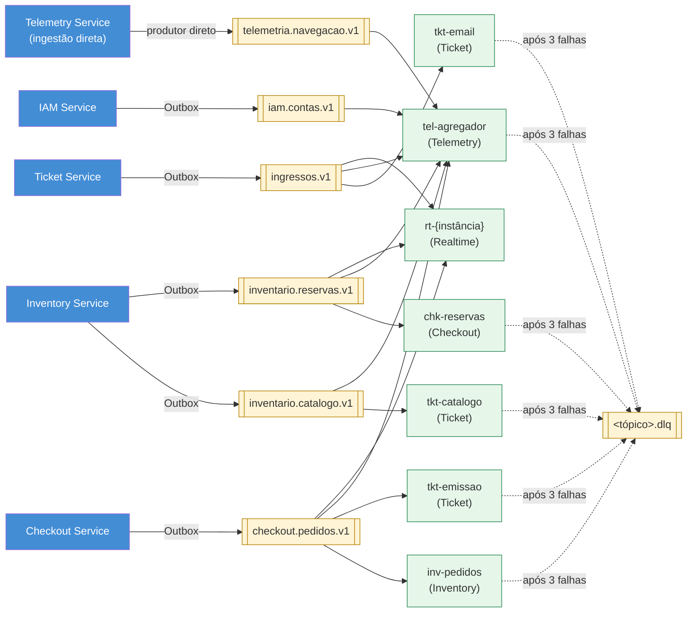
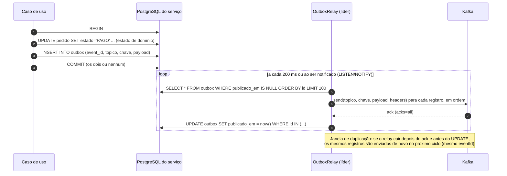
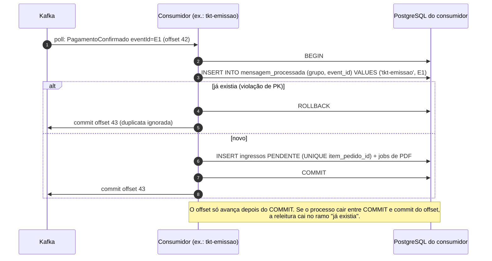

# 3. Descrição da Estrutura de Mensageria do Kafka

> Versão 1.0 · 04/11/2026 · Grupo 9 · Será atualizado nos Pacotes 3 e 4.
> Rótulos: **[Enunciado]** · **[Decisão do grupo, Pacote 1]** · **[Decisão do grupo, Pacote 2]** (escolha nova, aprovada pelo grupo em 04/11/2026 com os ADRs) · **[Proposta para revisão do grupo]** (detalhe ainda não revisado pelo grupo).
> Números de partições, retenções e nomes de tópicos abaixo são **decisões do grupo** (Pacote 2, ADR-005), não exigências do professor. O enunciado exige Kafka como provedor de streaming e o tratamento do dilema da escrita dupla e da idempotência no consumo.

## 3.1 Visão geral



*Figura 19. Tópicos, produtores e consumer groups. Cada grupo recebe todas as mensagens dos tópicos que assina; consumidores do mesmo grupo dividem as partições.*

## 3.2 Catálogo de tópicos

Convenção de nome: `<contexto>.<agregado>.v<versão-major>` **[Decisão do grupo, Pacote 2]**. Um tópico por agregado mantém em ordem todos os eventos da mesma reserva ou do mesmo pedido (ADR-005). O nome `inventario.reserva-expirada.v1`, citado como exemplo na spec da US18 do Pacote 1, passa a ser o tipo `ReservaExpirada` dentro de `inventario.reservas.v1`; o nome `PagamentoConfirmado` do Pacote 1 é mantido como tipo de evento.

| Tópico | Tipos de evento | Produtor | Consumer groups | Chave | Ordem necessária | Partições | Retenção | DLQ |
|---|---|---|---|---|---|---|---|---|
| `iam.contas.v1` | `OrganizadorAprovado`, `OrganizadorBloqueado`, `PapeisAlterados` | IAM (Outbox) | `tel-agregador` | `usuarioId` | Por usuário | 3 | 7 dias | `iam.contas.v1.dlq` |
| `inventario.catalogo.v1` | `EventoPublicado`, `EventoEncerrado`, `LoteAlterado`, `OperadoresAtribuidos` | Inventory (Outbox) | `tkt-catalogo`, `tel-agregador` | `eventoId` | Por evento | 3 | 7 dias | `inventario.catalogo.v1.dlq` |
| `inventario.reservas.v1` | `ReservaCriada`, `ReservaConfirmada`, `ReservaExpirada`, `ReservaLiberada` | Inventory (Outbox) | `chk-reservas`, `tel-agregador`, `rt-*` | `reservaId` | Por reserva | 6 | 7 dias | `inventario.reservas.v1.dlq` |
| `checkout.pedidos.v1` | `PedidoReservado`, `PagamentoIniciado`, `PagamentoRecusado`, `PagamentoConfirmado`, `PedidoExpirado`, `EstornoSolicitado` | Checkout (Outbox) | `tkt-emissao`, `inv-pedidos`, `tel-agregador`, `rt-*` | `pedidoId` | Por pedido | 6 | 7 dias | `checkout.pedidos.v1.dlq` |
| `ingressos.v1` | `IngressoEmitido`, `IngressoUtilizado` | Ticket (Outbox) | `tkt-email`, `tel-agregador`, `rt-*` | `ingressoId` | Por ingresso | 3 | 7 dias | `ingressos.v1.dlq` |
| `telemetria.navegacao.v1` | `EventoVisualizado`, `CheckoutIniciado` | Telemetry (ingestão HTTP) | `tel-agregador` | `eventoId` | Não (contagem) | 3 | 3 dias | `telemetria.navegacao.v1.dlq` |
| `<tópico>.dlq` | Mensagem original + cabeçalhos de erro | Qualquer consumidor | Inspeção manual (Kafka UI) e ferramenta de reprocessamento | Mesma do original | - | 1 | 14 dias | - |

Configuração comum:

| Item | Ambiente local (Compose) | Observação para produção |
|---|---|---|
| Brokers do cluster | 1 nó KRaft (broker e controller), por limite de memória do notebook de referência (RNF37) **[Decisão do grupo, Pacote 2, 04/11/2026]** | 3 nós |
| Fator de replicação | 1 | 3, com `min.insync.replicas=2` |
| Produtor | `acks=all`, `enable.idempotence=true`, `max.in.flight.requests.per.connection=5` | Igual (mantém ordem por partição com idempotência) |
| Consumidor | `enable.auto.commit=false`, `isolation.level=read_committed`, `max.poll.records=50` | Igual |
| Criação dos tópicos | Contêiner `kafka-init` cria tópicos e partições no `docker compose up` (`auto.create.topics.enable=false`) | Infra como código |

O mínimo de 3 partições atende RNF13. Os tópicos de reserva e pedido têm 6 partições porque concentram o pico da abertura de vendas.

### 3.2.1 Por que `telemetria.navegacao.v1` não usa Outbox

A navegação vem da SPA, não de uma mudança de estado no banco. O Telemetry Service recebe o lote por HTTP e publica direto no Kafka com produtor idempotente. Perder um evento de navegação em uma queda do broker afeta só a métrica do funil, não dinheiro nem assentos. **[Proposta para revisão do grupo]**

## 3.3 Envelope dos eventos

Todos os eventos de domínio usam o mesmo envelope JSON **[Decisão do grupo, Pacote 2 (ADR-005), detalhando RNF36]**:

```json
{
  "eventId": "0193f6a2-6b1e-7c11-9a4e-5d2f8e7a1b30",
  "tipo": "PagamentoConfirmado",
  "schemaVersion": 1,
  "ocorridoEm": "2026-11-04T23:09:58.412Z",
  "produtor": "checkout-service",
  "agregadoId": "0193f6a0-11aa-7d2e-8b55-0f3c2a9e4d71",
  "agregadoVersao": 4,
  "correlationId": "0193f6a0-11aa-7d2e-8b55-0f3c2a9e4d71",
  "causationId": "0193f6a2-5f00-7a00-8000-3e21c9d0aa10",
  "traceparent": "00-4bf92f3577b34da6a3ce929d0e0e4736-00f067aa0ba902b7-01",
  "dados": {
    "pedidoId": "0193f6a0-11aa-7d2e-8b55-0f3c2a9e4d71",
    "reservaId": "0193f6a0-2c4d-7e8f-9a01-b2c3d4e5f607",
    "compradorId": "6f1c2d3e-4b5a-4c6d-8e7f-90a1b2c3d4e5",
    "eventoId": "0193e0aa-0000-7000-8000-000000000001",
    "itens": [
      { "itemPedidoId": "0193f6a0-3333-7000-8000-000000000001", "assentoId": "0193e0ab-0000-7000-8000-0000000000a1", "descricao": "Pista A-12", "precoCentavos": 25000 }
    ],
    "totalCentavos": 25000,
    "pagoEm": "2026-11-04T23:09:58.398Z"
  }
}
```

| Campo | Uso |
|---|---|
| `eventId` | UUID v7 gerado na escrita da Outbox; chave de deduplicação dos consumidores (RNF07) |
| `tipo` e `schemaVersion` | Seleção do *handler* e da versão do esquema |
| `ocorridoEm` | Instante UTC do fato (não do envio) |
| `agregadoId` e `agregadoVersao` | Versão monotônica do agregado; o consumidor descarta versão menor ou igual à última aplicada |
| `correlationId` | Liga tudo o que nasceu do mesmo pedido |
| `causationId` | `eventId` ou requisição que causou este evento |
| `traceparent` | Também enviado como cabeçalho Kafka para o OpenTelemetry (RNF26) |

**Nunca vão no evento:** JWT, refresh token, cookie, dados de cartão, CPF completo, chave de assinatura do QR. O evento leva identificadores; quem precisa de mais dados consulta o dono.

Os exemplos de cada tipo estão em `pacote-2/contratos/` (arquivos JSON). Os JSON Schemas formais serão gerados no Pacote 3.

### 3.3.1 Evolução dos esquemas

| Mudança | Permitida em `v1`? | Como |
|---|---|---|
| Adicionar campo opcional | Sim | Consumidores ignoram campos desconhecidos (Jackson `FAIL_ON_UNKNOWN_PROPERTIES=false`) |
| Adicionar tipo de evento novo no tópico | Sim | Consumidor que não conhece o tipo faz *skip* com log e confirma o offset |
| Renomear ou remover campo, mudar tipo ou significado | Não | Novo tópico `...v2`; produtor publica nos dois durante a transição |
| Mudar a chave de partição | Não | Novo tópico `...v2` |

Testes de contrato em cada consumidor carregam os exemplos de `contratos/` e verificam que o *handler* aceita todas as versões ativas (RNF36).

## 3.4 Transactional Outbox (escrita dupla)



*Figura 20. Outbox: o estado e o evento são gravados juntos; o envio ao Kafka acontece depois (RNF06, US23).*

| Regra | Detalhe |
|---|---|
| Sem escrita direta no Kafka em caso de uso | ArchUnit proíbe `KafkaTemplate` fora do pacote `adapters.outbox` (RNF06) |
| Um relay ativo por serviço | Cada réplica tenta `pg_try_advisory_lock(<id do serviço>)`; só quem obtém o lock publica. Se a réplica cair, o lock é liberado com a conexão e outra assume em segundos |
| Ordem | O relay lê por `id` crescente e, se um envio falha, para o lote naquele registro e tenta de novo; registros posteriores não passam na frente |
| Broker fora | Registros ficam pendentes; o relay tenta com *backoff* até 30 s; métrica `outbox_pendentes` e alerta se > 1.000 por 1 min |
| Limpeza | Job diário apaga publicados há mais de 7 dias |
| Alternativa futura | Debezium lendo a tabela `outbox` (CDC), mantendo o mesmo formato de evento |

## 3.5 Semântica de entrega

O PulsePass trabalha com **entrega pelo menos uma vez** e **efeitos idempotentes**. Não prometemos "exatamente uma vez" ponta a ponta, porque o caminho cruza PostgreSQL, Kafka, sistema de arquivos e SMTP, e as transações do Kafka só cobrem o próprio Kafka.

| Origem de duplicata | Onde é absorvida |
|---|---|
| Relay republica após falha | `mensagem_processada (grupo, eventId)` no consumidor |
| Consumidor processou e caiu antes de confirmar o offset | Mesmo mecanismo: na releitura o `eventId` já está na Inbox |
| Rebalanceamento do grupo | Idem |
| Reprocessamento manual da DLQ ou *replay* do tópico | Idem; o reprocessamento nunca gera `eventId` novo |

## 3.6 Consumo idempotente



*Figura 21. Deduplicação na mesma transação do efeito (RNF07, US25).*

Regras:

1. **A Inbox e o efeito são gravados na mesma transação.** O `eventId` nunca é marcado como processado antes do efeito persistir, então uma falha no meio não descarta o evento.
2. **Transições guardadas por estado e versão.** Além da Inbox, todo efeito é condicional (`WHERE estado = :esperado`, `agregadoVersao > ultimaAplicada`). Um evento antigo que chega depois de um mais novo vira no-op registrado, não regressão de estado.
3. **Efeitos externos** (PDF, e-mail) não entram na transação. Eles viram *jobs* com identificador estável (seção 3.7).

## 3.7 PDF e notificações: falhas parciais

| Passo | Identificador estável | Se falhar no meio |
|---|---|---|
| Criar ingressos PENDENTE + `job_pdf` | `item_pedido_id` (único) | Transação inteira desfeita; evento relido |
| Gerar PDF e gravar em `ingressos/{ingressoId}.pdf` | `ingressoId` | Arquivo é sobrescrito na nova tentativa (gravação em arquivo temporário + `rename` atômico) |
| Marcar EMITIDO + Outbox `IngressoEmitido` | `ingressoId` | Só ocorre depois do arquivo existir; em falha o job repete |
| Enviar e-mail (`tkt-email`) | `Message-ID: <ingressoId.email@pulsepass.local>` | `NOTIFICACAO` registra `PENDENTE` antes do SMTP e `ENVIADA` depois |

**Limite de idempotência do provedor externo:** se o processo cair depois que o servidor SMTP aceitou a mensagem e antes de gravar `ENVIADA`, o e-mail é reenviado. O SMTP não deduplica; o `Message-ID` estável permite que clientes de e-mail agrupem a duplicata. Aceitamos esse risco: **um e-mail repetido é aceitável, um ingresso repetido não**. O mesmo vale para o simulador de pagamento, com a diferença de que o simulador **deduplica** pela `Idempotency-Key = pagamentoId` (ADR-003).

## 3.8 Retries, DLQ e ordem

| Etapa | Comportamento **[Decisão do grupo, Pacote 1 (RNF08)] + detalhes do ADR-005** |
|---|---|
| Erro transitório (banco indisponível, timeout) | Até 3 tentativas no próprio consumidor, *backoff* 1 s, 2 s, 4 s (`DefaultErrorHandler` do Spring Kafka). A partição fica parada durante essas tentativas, o que **preserva a ordem** |
| Erro permanente (JSON inválido, esquema desconhecido, violação de regra) | Vai direto para a DLQ, sem tentativas (classificado como não repetível) |
| Após 3 tentativas | Mensagem publicada em `<tópico>.dlq` com cabeçalhos `x-erro-classe`, `x-erro-mensagem`, `x-grupo`, `x-topico-original`, `x-particao`, `x-offset`, `x-tentativas`; offset original confirmado; consumo continua |
| Alerta | Métrica `kafka_dlq_mensagens_total` por tópico; alerta no Grafana se > 0 em 5 min |
| Inspeção | Kafka UI mostra a mensagem e os cabeçalhos |
| Reprocessamento | Ferramenta `dlq-replay` (comando do Telemetry/DevOps) republica a mensagem original no tópico de origem **com o mesmo `eventId`**; a Inbox e as transições guardadas garantem idempotência |

**Impacto na ordem.** Quando uma mensagem do agregado X vai para a DLQ, as mensagens seguintes do mesmo X continuam sendo processadas e podem chegar antes dela no reprocessamento. Isso é seguro porque os efeitos são transições guardadas por estado e versão: por exemplo, se `PedidoExpirado` (versão 3) já foi aplicado, um `PagamentoIniciado` (versão 2) reprocessado depois é ignorado. Não dependemos de ordem global entre tópicos: o Checkout trata `ReservaExpirada` sem saber se o Inventário já viu `PagamentoIniciado`, porque a decisão de venda é síncrona no Inventário (ADR-003).

## 3.9 Isolamento dos consumer groups

| Grupo | Serviço | Tópicos | Efeito | Escala |
|---|---|---|---|---|
| `chk-reservas` | Checkout | `inventario.reservas.v1` | `ReservaExpirada` → pedido Expirado | Até 6 réplicas (partições) |
| `inv-pedidos` | Inventory | `checkout.pedidos.v1` | `PedidoExpirado` → libera reserva (rede de segurança se a chamada síncrona falhou) | Até 6 |
| `tkt-emissao` | Ticket | `checkout.pedidos.v1` | `PagamentoConfirmado` → ingressos | Até 6 |
| `tkt-catalogo` | Ticket | `inventario.catalogo.v1` | Projeção de eventos e operadores vinculados | Até 3 |
| `tkt-email` | Ticket | `ingressos.v1` | `IngressoEmitido` → e-mail | Até 3 |
| `tel-agregador` | Telemetry | Todos | Agregados de funil e vendas | Até 3 |
| `rt-{instância}` | Realtime | `inventario.reservas.v1`, `checkout.pedidos.v1`, `ingressos.v1` | Mensagens de tela; grupo exclusivo por instância, `auto.offset.reset=latest`, sem Inbox (mensagens de tela são efêmeras) | 1 consumidor por instância |

Ingressos e Telemetria leem `checkout.pedidos.v1` em grupos diferentes, então **cada um recebe todas as mensagens**; não competem. Dentro de um grupo, réplicas dividem as partições.

## 3.10 Cenários de falha

| Cenário | O que acontece | Resultado |
|---|---|---|
| Kafka indisponível durante o checkout | Pedido vai a Pago normalmente; evento fica na Outbox; relay tenta com *backoff* | Ingresso emitido quando o broker volta; nada perdido (RNF06, CS3) |
| Mensagem duplicada | Inbox encontra `(grupo, eventId)` | Ignorada, offset confirmado (RNF07) |
| Mensagem fora de ordem | Versão do agregado menor ou estado não esperado | No-op registrado; métrica `evento_desatualizado_total` |
| Mensagem malformada | Falha de desserialização | Direto para DLQ, consumo continua (RNF08) |
| *Replay* do tópico inteiro | Todos os `eventId` já estão na Inbox (retenção 14 dias > 7 dias do tópico) | Nenhum efeito duplicado; teste do RNF07 reprocessa o tópico |
| Reinício do consumidor | Retoma do último offset confirmado; pode reler até `max.poll.records` mensagens | Inbox absorve (RNF16) |
| Erro depois de efeito parcial (ex.: PDF gerado, banco caiu antes de EMITIDO) | Job repete; arquivo sobrescrito; mesmo `ingressoId` | Um ingresso, um arquivo |
| Relay cai entre ack e `publicado_em` | Republica no próximo ciclo | Duplicata absorvida pelo consumidor |
| `ReservaExpirada` chega depois de `PagamentoConfirmado` do mesmo pedido | Checkout: pedido já Pago, transição inválida | Ignorado e registrado (US21); o Inventário nunca emitiria `ReservaExpirada` para reserva CONFIRMADA |

## 3.11 Rastreabilidade

| Requisito | Seção |
|---|---|
| Dilema da escrita dupla [Enunciado], RNF06, US23 | 3.4 |
| Idempotência no consumo [Enunciado], RNF07, US25 | 3.5, 3.6, 3.7 |
| RNF08, US25 (DLQ após 3 falhas) | 3.8 |
| RNF13 (≥ 3 partições, escala por partição) | 3.2, 3.9 |
| RNF26 (trace em cabeçalhos Kafka) | 3.3 |
| RNF28 (ingestão de navegação e compras) | 3.2.1, 3.9 |
| RNF36 (esquema versionado) | 3.3, 3.3.1 |
| US19 (`ReservaExpirada` publicado) | 3.2, 3.10 |
