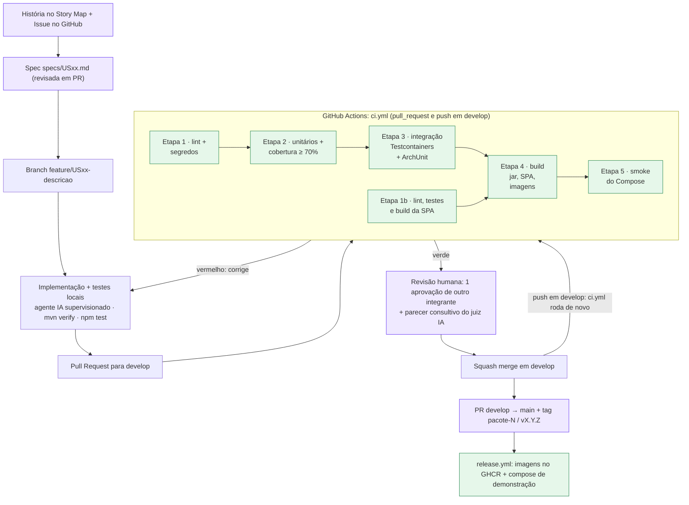

# 4. Descrição Esquemática da Pipeline de Desenvolvimento

> Versão 1.0 · 04/11/2026 · Grupo 9 · Será atualizado nos Pacotes 3 e 4.
> Rótulos: **[Enunciado]** · **[Decisão do grupo, Pacote 1]** · **[Proposta para revisão do grupo]**.
> **Estado real em 04/11/2026:** o repositório tem só documentação. Não existem ainda código dos serviços, `docker-compose.yml`, `.github/workflows/` nem branch `develop`. Tudo neste documento que fala em executar é **planejado**; os comandos aparecem como **comandos previstos**, não como resultados.

## 4.1 Exigência e escopo

O enunciado exige **[Enunciado]**:
- pipeline de CI no GitHub Actions ou GitLab executando **linters, testes e compilação a cada Pull Request ou Merge na branch `develop`**;
- testes unitários cobrindo máquinas de estado com **≥ 70% de cobertura de domínio**;
- testes de integração com **Testcontainers reais de PostgreSQL e Kafka** (e Redis, que o PulsePass usa);
- ambiente completo orquestrado via **`docker-compose.yml`** (backend, frontend, bancos, Kafka e UI de mensageria);
- testes de carga como bônus desejável.

O grupo acrescentou no Pacote 1 metas próprias (rotuladas como **meta do grupo** abaixo): ArchUnit (RNF34), PIT ≥ 70% (RNF32), ≥ 90% de ramos na FSM (RNF04), gitleaks (RNF23), varredura de dependências (RNF24), Lighthouse (RNF43) e publicação de imagens no GHCR (RNF40).

## 4.2 Fluxo de ponta a ponta



*Figura 22. Pipeline de desenvolvimento. Roxo: portões humanos. Verde: etapas automatizadas.*

O merge de um PR em `develop` não é um evento próprio do GitHub Actions: ele gera um evento `push` em `develop`. Por isso o workflow usa os gatilhos `pull_request` (destinos `develop` e `main`) e `push` (branch `develop`) **[Proposta para revisão do grupo]** (ADR-006).

## 4.3 Jobs da CI

| # | Job | Depende de | Ambiente | Comandos previstos | Falha quando | Artefatos | Origem |
|---|---|---|---|---|---|---|---|
| 1 | `lint` | - | `ubuntu-latest`, Temurin 21, cache Maven | `mvn -B -ntp spotless:check checkstyle:check`; `gitleaks detect --redact` | Qualquer violação de estilo ou segredo encontrado | Relatório Checkstyle | [Enunciado] lint + meta do grupo (RNF23, RNF35) |
| 1b | `frontend` | - | Node 22, cache npm | `npm ci`; `npm run lint`; `npm run typecheck`; `npm test -- --coverage`; `npm run build` | Erro de ESLint/Prettier, tipo, teste ou build | `spa-dist`, cobertura | [Enunciado] lint, testes e compilação |
| 2 | `unit` | `lint` | Temurin 21 | `mvn -B -ntp test jacoco:report jacoco:check` | Teste falhou; cobertura de linhas do pacote `domain` < 70%; ramos da FSM < 90% | `jacoco.xml` por serviço, Surefire | [Enunciado] ≥ 70% de domínio + meta do grupo (RNF04, RNF30) |
| 3 | `integration` | `unit` | `ubuntu-latest` (Docker já disponível no runner) | `mvn -B -ntp verify -Pintegration` (Testcontainers: `postgres:16`, `apache/kafka:3.8.0`, `redis:7`) + regras ArchUnit | Teste de integração ou regra de arquitetura falhou | Failsafe, logs dos contêineres em falha | [Enunciado] Testcontainers + meta do grupo (RNF31, RNF34) |
| 4 | `build` | `integration`, `frontend` | Temurin 21, Docker Buildx | `mvn -B -ntp -DskipTests package`; `docker buildx build` de cada serviço (sem publicar) | Compilação ou build de imagem falhou | JARs, imagens em cache do Buildx | [Enunciado] compilação |
| 5 | `compose-smoke` | `build` | Runner com Docker | `cp .env.example .env`; `docker compose up -d --wait --wait-timeout 300`; script de *smoke* (health de todos, login de teste, `GET /eventos`); `docker compose down -v` | Algum serviço não fica saudável em 5 min ou o *smoke* falha | `docker compose logs` em falha | Meta do grupo (RNF17, RNF37) |
| 6 | `security` | `build` | - | `trivy image` nas imagens; OWASP Dependency-Check | Vulnerabilidade crítica (só bloqueia PR para `main`) | Relatório SARIF | Meta do grupo (RNF24) |
| 7 | `mutation` | `unit` | - | `mvn -B -ntp -pl inventory-service,checkout-service org.pitest:pitest-maven:mutationCoverage` | *Mutation score* < 70% (só em PR para `main` e agendado semanal) | Relatório PIT | Meta do grupo (RNF32) |
| 8 | `ai-review` | - | Ação de revisão por IA | Comenta o PR comparando o diff com a spec | Nunca bloqueia (consultivo) | Comentário no PR | Meta do grupo (Pacote 1, 1.6) |

Duração-alvo: ≤ 15 min (RNF39). Testes de carga (k6) **não** fazem parte da CI de PR: ficam em workflow manual (`workflow_dispatch`) e são bônus do enunciado (RNF33).

### 4.3.1 Detalhes de execução

| Tema | Decisão **[Proposta para revisão do grupo]** |
|---|---|
| Docker para Testcontainers | Runners `ubuntu-latest` do GitHub já têm Docker; o Testcontainers usa o *socket* padrão. Ryuk fica ligado para limpar contêineres |
| Versões fixadas | Imagens com tag exata (`postgres:16.4`, `apache/kafka:3.8.0`, `redis:7.4`, `quay.io/keycloak/keycloak:26.0`); ações do GitHub fixadas por versão maior e revisadas pelo Dependabot |
| Caches | `actions/setup-java` com cache Maven; `actions/setup-node` com cache npm; cache de camadas do Buildx (`type=gha`) |
| Monorepo | Maven multi-módulo na raiz (`services/*`) + `frontend/`; `paths` no workflow evita rodar o job da SPA quando só o backend muda (o job obrigatório é marcado como sucesso por um *job* de agregação) |
| Relatórios | Cobertura e testes publicados como artefatos e como resumo do job (`$GITHUB_STEP_SUMMARY`) |
| Segredos | O CI não precisa de segredos reais: Testcontainers e Compose usam credenciais geradas para o teste. `GITHUB_TOKEN` só no `release.yml` para o GHCR |
| Permissões | `permissions: contents: read` por padrão; `packages: write` só no `release.yml` |

### 4.3.2 Esboço do workflow (previsto, ainda não versionado)

O arquivo abaixo **não** foi criado em `.github/workflows/` porque os projetos Maven e npm que ele chama ainda não existem; criar o workflow agora geraria execuções vermelhas sem significado. Ele será adicionado junto com o esqueleto dos serviços (US33).

```yaml
name: ci
on:
  pull_request:
    branches: [develop, main]
  push:
    branches: [develop]
permissions:
  contents: read
concurrency:
  group: ci-${{ github.ref }}
  cancel-in-progress: true
jobs:
  lint:
    runs-on: ubuntu-latest
    steps:
      - uses: actions/checkout@v4
        with: { fetch-depth: 0 }
      - uses: actions/setup-java@v4
        with: { distribution: temurin, java-version: '21', cache: maven }
      - run: mvn -B -ntp spotless:check checkstyle:check
      - uses: gitleaks/gitleaks-action@v2
  frontend:
    runs-on: ubuntu-latest
    defaults: { run: { working-directory: frontend } }
    steps:
      - uses: actions/checkout@v4
      - uses: actions/setup-node@v4
        with: { node-version: '22', cache: npm, cache-dependency-path: frontend/package-lock.json }
      - run: npm ci && npm run lint && npm run typecheck && npm test -- --coverage && npm run build
  unit:
    needs: lint
    runs-on: ubuntu-latest
    steps:
      - uses: actions/checkout@v4
      - uses: actions/setup-java@v4
        with: { distribution: temurin, java-version: '21', cache: maven }
      - run: mvn -B -ntp test jacoco:report jacoco:check
  integration:
    needs: unit
    runs-on: ubuntu-latest
    steps:
      - uses: actions/checkout@v4
      - uses: actions/setup-java@v4
        with: { distribution: temurin, java-version: '21', cache: maven }
      - run: mvn -B -ntp verify -Pintegration
  build:
    needs: [integration, frontend]
    runs-on: ubuntu-latest
    steps:
      - uses: actions/checkout@v4
      - uses: actions/setup-java@v4
        with: { distribution: temurin, java-version: '21', cache: maven }
      - run: mvn -B -ntp -DskipTests package
      - uses: docker/setup-buildx-action@v3
      - run: docker buildx bake --file docker-bake.hcl
  compose-smoke:
    needs: build
    runs-on: ubuntu-latest
    steps:
      - uses: actions/checkout@v4
      - run: cp .env.example .env
      - run: docker compose up -d --build --wait --wait-timeout 300
      - run: ./scripts/smoke.sh
      - if: failure()
        run: docker compose logs --no-color > compose.log
      - run: docker compose down -v
```

## 4.4 Ambiente Docker Compose

O `docker-compose.yml` é o ambiente de desenvolvimento e de demonstração **[Enunciado]**, com os serviços listados no RNF37 **[Decisão do grupo, Pacote 1]**. A tabela abaixo é o desenho proposto.

| Serviço Compose | Imagem / build | Rede | Volume | Saúde (healthcheck) | Depende de (saudável) | Porta no host |
|---|---|---|---|---|---|---|
| `postgres` | `postgres:16.4` | `data` | `pg-data` | `pg_isready` | - | - |
| `postgres-init` | script SQL montado em `/docker-entrypoint-initdb.d` | `data` | - | (roda na 1ª subida do Postgres) | - | - |
| `redis` | `redis:7.4` (`--appendonly yes`, ACL via arquivo) | `data` | `redis-data` | `redis-cli ping` | - | - |
| `kafka` | `apache/kafka:3.8.0` (KRaft, 1 broker) | `data` | `kafka-data` | `kafka-broker-api-versions.sh` | - | - |
| `kafka-init` | mesma imagem; cria tópicos e DLQs | `data` | - | termina com código 0 | `kafka` | - |
| `kafka-ui` | `kafbat/kafka-ui` | `data`, `ops` | - | HTTP `/actuator/health` | `kafka` | 8089 |
| `keycloak` | `quay.io/keycloak/keycloak:26.0` com `--import-realm` | `backend`, `data` | realm em `infra/keycloak/pulsepass-realm.json` | HTTP `/health/ready` | `postgres` | 8180 |
| `mailpit` | `axllent/mailpit` | `backend` | - | HTTP `/livez` | - | 8025 (UI) |
| `payment-simulator` | build `services/payment-simulator` | `backend` | - | `/actuator/health` | - | - |
| `iam-service`, `inventory-service`, `checkout-service`, `ticket-service`, `telemetry-service` | build `services/<nome>` | `backend`, `data` | `ticket-pdfs` (só Ticket) | `/actuator/health/readiness` | `postgres`, `redis`, `kafka-init` (concluído), `keycloak` | - |
| `realtime-service` | build `services/realtime-service` | `backend`, `data` | - | `/actuator/health/readiness` | `kafka`, `keycloak` | - |
| `api-gateway` | build `services/api-gateway` | `edge`, `backend` | - | `/actuator/health` | serviços de domínio | - |
| `frontend` | build `frontend/` (Nginx servindo a SPA, TLS local e proxy para `/api` e `/ws`) | `edge` | - | HTTP `/` | `api-gateway`, `realtime-service` | 8443 |
| `otel-collector`, `prometheus`, `grafana`, `jaeger` | imagens oficiais com configuração em `infra/` | `ops`, `backend` | `prom-data`, `grafana-data` | HTTP de cada um | - | 3000 (Grafana), 16686 (Jaeger) |

| Tema | Desenho |
|---|---|
| Redes | `edge` (só Nginx e Gateway), `backend` (serviços), `data` (bancos e broker), `ops` (observabilidade). Serviços de domínio não publicam portas no host |
| Inicialização | `postgres-init` cria os bancos `iam`, `inv`, `chk`, `tkt`, `tel`, `keycloak` e um usuário por banco; cada serviço aplica suas migrações Flyway ao subir; `kafka-init` cria tópicos com partições e DLQs; Keycloak importa o realm com papéis, clientes e usuários de teste |
| Configuração | Variáveis em `.env` (fora do Git); `.env.example` com valores de exemplo sem segredos reais (RNF23, RNF38). Perfis Spring `local` e `ci` |
| Recursos | Limites de memória por serviço (`mem_limit`: 512 MB por serviço Java, 1 GB Kafka, 768 MB Keycloak). Estimativa total ≈ 8 a 9 GB, compatível com o notebook de referência de 16 GB do Pacote 1 |
| Escala | `docker compose up --scale inventory-service=2 --scale ticket-service=2` sem mudar código (RNF13); o Gateway resolve réplicas pelo DNS do Compose |
| Comando de subida (previsto) | `cp .env.example .env && docker compose up -d --wait` |

## 4.5 Build de imagem, publicação e implantação

| Etapa | Quando | Onde | Estado |
|---|---|---|---|
| Build de imagem | Todo PR e push em `develop` (job `build`) | Runner do GitHub, sem publicar | Planejado |
| Publicação | Tag `pacote-N` ou `vX.Y.Z` em `main` (`release.yml`) | GHCR, tags `sha-<commit>` e versão (RNF40) | Planejado |
| Implantação | Manual: `docker compose -f docker-compose.yml -f docker-compose.demo.yml up -d` usando as imagens publicadas | Máquina de um integrante ou laboratório | Planejado |

**Sem implantação em nuvem** **[Decisão do grupo, Pacote 1 (P07)]**: a Visão define execução local/acadêmica. O fórum da disciplina sobre e-mails para a AWS Academy (26/10/2026) não muda sozinho o escopo desta entrega; se o professor pedir implantação na AWS, o grupo registrará um novo ADR.

## 4.6 Compromisso da iteração 2: estado real

O processo do Pacote 1 (seção 1.1) previu para a iteração 2 o "esqueleto dos serviços + docker-compose + CI". Esse compromisso **não faz parte da lista do professor para o Pacote 2** (que pede descrições), mas registramos o estado com honestidade:

| Item | Estado em 04/11/2026 | Próximo passo | História |
|---|---|---|---|
| Esqueleto Maven multi-módulo dos serviços | Não iniciado | Gerar módulos com Spring Initializr e camadas hexagonais vazias | US32 |
| `docker-compose.yml` | Não iniciado | Subir infraestrutura (Postgres, Redis, Kafka, Kafka UI, Keycloak, Mailpit) primeiro, depois os serviços | US32 |
| `.github/workflows/ci.yml` | Não iniciado (esboço na seção 4.3.2) | Versionar junto com o esqueleto, para não ter CI apontando para arquivos inexistentes | US33 |
| Branch `develop` e proteção de branch | Não existe; proteção não verificada | Integrante com permissão de admin cria e configura (documento 5) | US33 |

Esta entrega priorizou os cinco documentos pedidos pelo professor. **[Proposta para revisão do grupo]**: o esqueleto passa a ser a primeira tarefa da iteração 3, antes das histórias da fatia MVP.

## 4.7 Rastreabilidade

| Requisito | Seção |
|---|---|
| CI a cada PR ou merge em `develop` com lint, testes e compilação [Enunciado], RNF39, US33 | 4.2, 4.3 |
| ≥ 70% de cobertura de domínio [Enunciado], RNF30 | 4.3 (job `unit`) |
| Testcontainers PostgreSQL e Kafka (e Redis) [Enunciado], RNF31 | 4.3 (job `integration`) |
| Compose completo [Enunciado], RNF17, RNF37, US32 | 4.4 |
| Testes de carga (bônus) [Enunciado], RNF33 | 4.3 (workflow manual) |
| RNF23, RNF24, RNF32, RNF34, RNF35, RNF40 | 4.3, 4.5 |
