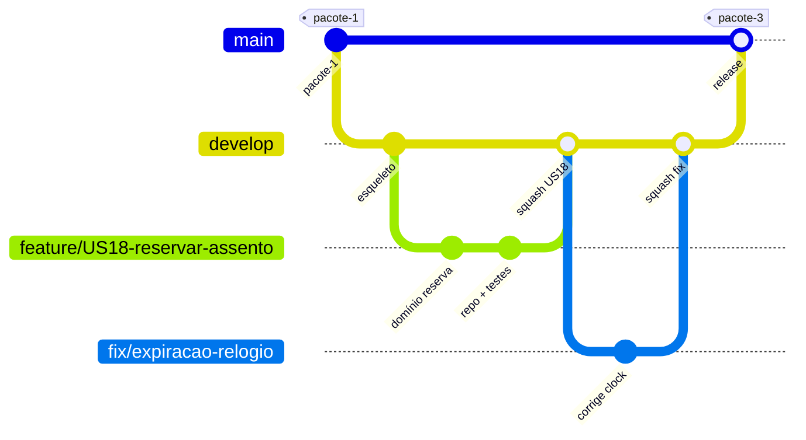
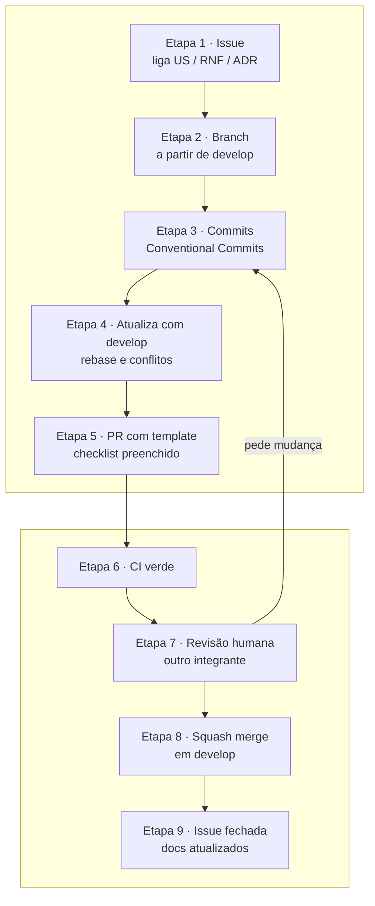

# 5. Descrição do Processo de GCS (Gerenciamento da Configuração de Software)

> Versão 1.0 · 04/11/2026 · Grupo 9 · Será atualizado nos Pacotes 3 e 4.
> Rótulos: **[Enunciado]** · **[Decisão do grupo, Pacote 1]** · **[Decisão do grupo, Pacote 2]** (escolha nova, aprovada pelo grupo em 04/11/2026 com os ADRs) · **[Proposta para revisão do grupo]** (detalhe ainda não revisado pelo grupo).
> O enunciado pede: ferramenta, descrição do fluxo de trabalho (branches, regras de uso, ...). O fluxo de branches e as regras de PR foram definidos no Pacote 1 (seção 1.7) e são mantidos aqui; este documento detalha o processo e separa **regra definida** de **configuração técnica já ativa**.

## 5.1 Ferramentas

| Ferramenta | Papel no GCS |
|---|---|
| **Git** | Controle de versão de tudo que é item de configuração |
| **GitHub** (repositório `Mateus-Tieppo/construcao-de-software`) | Repositório remoto, Pull Requests, revisão, proteção de branches |
| **GitHub Issues + Projects** | Pedidos de mudança, backlog da iteração, ligação com histórias (US) e RNFs |
| **GitHub Actions** | Verificação automática de cada mudança (documento 4) |
| **GHCR** | Registro das imagens versionadas (RNF40) |
| **Conventional Commits** | Padrão de mensagens que permite gerar notas de versão |
| **Dependabot** | Pedidos de atualização de dependências e ações |
| **Claude Code** | Agente de IA que escreve código, specs e documentos sob supervisão; nunca faz merge |

## 5.2 Itens de configuração

| Item | Onde fica | Controle |
|---|---|---|
| Specs das histórias | `specs/USxx-*.md` | PR com revisão; mudança de comportamento sem spec atualizada reprova o PR (Pacote 1, 1.7) |
| Código-fonte dos serviços e da SPA | `services/*`, `frontend/` | PR + CI + revisão |
| Contratos | OpenAPI gerado no build; eventos em `contratos/` e JSON Schemas | Mudança incompatível exige nova versão (`v2`), ver documento 3 |
| Migrações de banco | `services/<s>/src/main/resources/db/migration` (Flyway, `V<n>__descricao.sql`) | Nunca editar migração já mesclada em `develop`; correção é migração nova |
| Infraestrutura | `docker-compose.yml`, `infra/` (realm Keycloak, Prometheus, Grafana, tópicos) | PR + job `compose-smoke` |
| Pipelines | `.github/workflows/*` | PR com revisão de quem conhece a pipeline |
| Dependências | `pom.xml`, `package-lock.json`, `pacote-2/package-lock.json` | Versões fixadas; atualização por PR |
| Documentação e ADRs | `pacote-N/`, `pacote-N/adr/`, `CLAUDE.md` | PR com revisão |
| Entregas | `pacote-N/PacoteN_Grupo9.pdf` + tag `pacote-N` | Baseline |
| Enunciado | `contexto/` | Cópia do Moodle: não é alterada pelo grupo |
| **Fora do Git** | `.env`, chaves, senhas, tokens | `.gitignore` + gitleaks no CI (RNF23) |

## 5.3 Modelo de branches

**[Decisão do grupo, Pacote 1 (1.7)]**: Git Flow simplificado.



*Figura 23. Branches e baselines. Exemplo ilustrativo; as branches `develop` e `feature/*` ainda não existem.*

| Branch | Para que serve | Nasce de | Volta para | Regra |
|---|---|---|---|---|
| `main` | Versões entregues (uma por pacote) | - | - | Só recebe PR vindo de `develop` (ou `docs/*` enquanto não houver código, ver 5.8); cada merge recebe tag |
| `develop` | Integração contínua do trabalho | `main` | `main` | Só recebe PR com CI verde e 1 aprovação |
| `feature/USxx-descricao` | Uma história do backlog | `develop` | `develop` | Uma história por branch; vida curta (≤ 1 semana) |
| `fix/descricao` | Correção de defeito | `develop` (ou `main`, se for na entrega) | origem | Precisa de teste que reproduz o defeito |
| `docs/descricao` | Só documentação | `develop` ou `main` | origem | Mesmo fluxo de PR |

Proibido: *push* direto em `main` e `develop`, *force push* nessas branches, merge sem PR.

## 5.4 Ciclo de uma mudança



*Figura 24. Ciclo de uma mudança.*

| Passo | Regra |
|---|---|
| 1. Issue | Toda mudança nasce de uma issue com o ID da história (`US18`) ou do RNF; bug traz passos para reproduzir |
| 2. Branch | Nome `feature/US18-reservar-assento`; criada a partir de `develop` atualizado |
| 3. Commits | `tipo(escopo): resumo` em português, ex.: `feat(inventario): reserva atômica de assentos (US18)`. Tipos: `feat`, `fix`, `docs`, `test`, `refactor`, `chore`, `ci`. Commits gerados com IA levam o trailer `Co-Authored-By` do agente |
| 4. Atualização | `git rebase develop` antes de abrir o PR; conflitos resolvidos por quem é dono da branch, com os testes rodando de novo |
| 5. PR | Título igual ao commit final; descrição com `Closes #<issue>`; template da seção 5.5 preenchido |
| 6. CI | Todos os jobs obrigatórios verdes (documento 4) |
| 7. Revisão | Pelo menos 1 aprovação de **outro** integrante humano. O parecer do juiz de IA é consultivo. Quem escreveu a spec ou o código não aprova o próprio PR |
| 8. Merge | *Squash merge* em `develop` (histórico linear, um commit por história); branch apagada após o merge |
| 9. Fechamento | Issue fechada pelo PR; se mudou comportamento, spec e documentação do pacote atualizadas no mesmo PR |

## 5.5 Template de Pull Request

O arquivo `.github/pull_request_template.md` (a criar com o esqueleto, US33) terá:

```markdown
## O que muda
Closes #<issue> · História: USxx · Spec: specs/USxx-*.md · ADRs: ...

## Checklist
- [ ] Escopo limitado à história; arquivos fora do escopo explicados
- [ ] Contratos: OpenAPI e eventos atualizados; mudança incompatível virou v2
- [ ] Migração nova (sem editar migração antiga), se mexeu em banco
- [ ] Testes: unitários do domínio, integração com Testcontainers quando toca banco, Kafka ou Redis
- [ ] Evidência: print, log ou saída do teste dos critérios de aceitação da spec
- [ ] Sem segredos, tokens ou dados pessoais reais no diff
- [ ] Documentação e spec atualizadas
- [ ] Uso de IA: o que foi gerado por agente e o que o autor verificou manualmente
```

A linha de uso de IA cumpre o processo do Pacote 1: o agente gera, o humano verifica e responde pelo código no review.

## 5.6 Versionamento, baselines e releases

| Conceito | Regra **[Proposta para revisão do grupo, sobre o Pacote 1]** |
|---|---|
| Baseline de entrega | Tag anotada `pacote-1` … `pacote-4` no commit de `main` que gerou o PDF entregue |
| Versão do produto | SemVer `vMAJOR.MINOR.PATCH` a partir do Pacote 3 (`v0.3.0` no Pacote 3, `v1.0.0` no Pacote 4) |
| Notas de versão | GitHub Release gerado a partir dos Conventional Commits desde a tag anterior |
| Imagens | Publicadas com `sha-<commit>` e com a versão, a partir da tag (documento 4) |
| Reprodução de uma entrega | `git checkout pacote-N` + `docker compose up` com as imagens daquela tag; o PDF da entrega é regenerado com `npm ci && npm run pdf` dentro de `pacote-N/` |
| Eventos e APIs | Versão no nome do tópico (`.v1`) e no caminho da API quando houver quebra (`/v2/...`) |

## 5.7 Configuração, segredos e mudanças

| Tema | Regra |
|---|---|
| Segredos | Nunca no Git. `.env` local; `.env.example` só com nomes e valores de exemplo; segredos de CI (quando houver) em *GitHub Secrets* |
| Configuração por ambiente | Perfis Spring `local`, `ci`, `demo`; variáveis de ambiente sobrescrevem tudo (RNF38) |
| Migrações | Flyway versionado; a mesma sequência roda em dev, CI e demonstração |
| Mudança de contrato | Discutida na issue; consumidores atualizados antes de o produtor remover algo |
| Rollback | `git revert` do commit de *squash* em `develop` (nunca reescrever histórico publicado); para uma entrega já marcada, nova tag de correção |
| Débito e exceções | Desvio consciente de uma regra vira issue com rótulo `debito-tecnico` |

## 5.8 Estado real da configuração (04/11/2026)

| Regra | Definida | Configurada no GitHub | Observação |
|---|---|---|---|
| Branches `main` e `develop` | Sim (Pacote 1) | Só `main` existe | `develop` será criada com o esqueleto (US33) |
| PR obrigatório, 1 aprovação, CI verde | Sim (Pacote 1) | **Não verificado** | Requer integrante com permissão de admin; não foi alterado nesta entrega |
| Workflows de CI | Sim (documento 4) | Não existem | Esboço na seção 4.3.2 |
| Tags de baseline | Sim | **Não**: o repositório remoto não tem nenhuma tag (`git ls-remote --tags`, 04/11/2026) | Criar `pacote-1` (commit `644f965`) e `pacote-2` em `main` após a aprovação do grupo |
| Fluxo de PR para documentos | Sim | Em uso | O plano do Pacote 2 entrou por PR (`docs/plano-pacote-2` → `main`, PR #1); este pacote entra por `docs/pacote-2` → `main` |

Enquanto não houver código nem `develop`, as entregas documentais seguem `docs/*` → PR → `main`, com revisão de outro integrante antes do merge **[Decisão do grupo, Pacote 2]** (ADR-006). As regras de proteção estão descritas como processo; nenhuma aprovação ou proteção técnica é alegada sem ter sido configurada.

## 5.9 Rastreabilidade

| Exigência | Seção |
|---|---|
| Ferramenta [Enunciado] | 5.1 |
| Fluxo de trabalho: branches [Enunciado] | 5.3 |
| Regras de uso [Enunciado] | 5.3, 5.4, 5.5, 5.7 |
| Revisão humana e uso de IA (Pacote 1, 1.4 e 1.7) | 5.4, 5.5 |
| Baselines e reprodução de entregas | 5.6 |
| RNF23 (sem segredos), RNF38 (configuração externalizada), RNF39 (proteção de branch) | 5.7, 5.8 |
