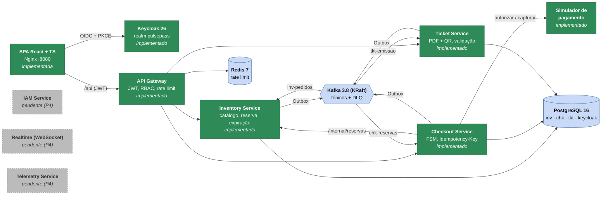

# 1. Checkpoint do Desenvolvimento

> Versão 1.0 · 23/11/2026 · Grupo 9 (Gabriel Gerhardt de Marque, Mateus Granja de Andrade Madalosso Tieppo, Filipe Tesche Roman).
> Rótulos: **[Enunciado]** exigência do professor · **[Decisão do grupo, Pacote N]** escolha já registrada · **[Decisão do grupo, Pacote 3]** escolha nova deste checkpoint · **[Pendente, Pacote 4]** ainda não implementado.
> Este documento registra o **estado real** do código em 23/11/2026. Só aparece como "verificado" o que tem evidência de execução na CI do GitHub Actions (seção 1.6).

## 1.1 O que o Pacote 3 pede

O enunciado define o Pacote 3 como **[Enunciado]**:

1. link para o repositório com o estágio corrente de desenvolvimento;
2. documentação entregue nos Pacotes 1 e 2 atualizada.

| Item | Onde está |
|---|---|
| Repositório | https://github.com/Mateus-Tieppo/construcao-de-software |
| Código deste checkpoint | branch `feature/pacote-3-checkpoint`, integrada à `develop` pelo Pull Request #3 (https://github.com/Mateus-Tieppo/construcao-de-software/pull/3) |
| Documentação atualizada | `pacote-3/documentacao/pacote-1/` e `pacote-3/documentacao/pacote-2/`; o que mudou em cada documento está em `pacote-3/02-registro-atualizacoes.md` |
| PDF consolidado | `pacote-3/Pacote3_Grupo9.pdf` |

## 1.2 Visão geral do que já roda

A fatia implementada cobre o **fluxo crítico de compra de ponta a ponta**, que concentra os requisitos mais difíceis do enunciado: zero overselling, expiração em 10 minutos, FSM do pedido, Idempotency-Key, Transactional Outbox para o Kafka, consumo idempotente, ingresso em PDF com QR Code e RBAC com Keycloak.



*Figura 1. Contêineres do C2 (Pacote 2, Figura 2a) com o estado de implementação em 23/11/2026. Verde: implementado e coberto pela CI. Cinza tracejado: pendente para o Pacote 4.*

## 1.3 Estado por módulo do enunciado

| Módulo do enunciado | Implementado neste checkpoint | Pendente para o Pacote 4 |
|---|---|---|
| **1. Identidade e Governança (IAM)** | Keycloak com realm versionado (`infra/keycloak/pulsepass-realm.json`): papéis `cliente`, `organizador`, `operador`, `admin`; cliente público com PKCE; auto-cadastro; usuários de demonstração (senha vinda do `.env`). Login OIDC na SPA (`keycloak-js`). Gateway e cada serviço validam o JWT pela JWKS e aplicam RBAC por rota | IAM Service (BFF de login, refresh token cifrado no Redis, revogação), credenciamento e aprovação de organizadores (US05, US06), trilha de auditoria (US08), validação de `iss`/`aud` |
| **2. Inventário e Concorrência** | Catálogo (US14, US15, US17); criação de evento com setores, mapa de assentos e lote, e publicação (US09 a US12, só API); **reserva atômica tudo ou nada** por `UPDATE` condicional em ordem de id (US18, ADR-002); confirmação dentro do prazo pelo relógio do banco (ADR-003); liberação; **expiração em 10 min** com `FOR UPDATE SKIP LOCKED` (US19); eventos `ReservaCriada`, `ReservaConfirmada`, `ReservaExpirada`, `ReservaLiberada` e `EventoPublicado` pela Outbox | Cache Redis do catálogo (RNF09), vínculo de operadores ao evento, telas do organizador, autenticação *client credentials* em `/internal/*` |
| **3. Transações e Checkout** | **FSM do pedido** com os cinco estados do enunciado (domínio puro); **Idempotency-Key** obrigatória nos `POST` com replay da resposta, 422 para corpo diferente e 409 para requisição em andamento; criação com reserva, pagamento em duas fases (autorizar, confirmar no Inventário, capturar), recusa volta a Reservado (US24, parcial), pagamento tardio cancela a autorização; cancelamento; consumo de `ReservaExpirada`; **Transactional Outbox** em todas as transições | Resilience4j (circuit breaker), `ReconciliacaoWorker` para pedidos parados em Aguardando |
| **4. Mensageria e Despacho** | Consumo de `PagamentoConfirmado` com **Inbox na mesma transação**; um ingresso por item (`UNIQUE item_pedido_id`); job assíncrono gera **PDF com carimbo de tempo e QR Code assinado (Ed25519)**; `IngressoEmitido` pela Outbox; download do PDF (US25, US26); **validação de uso único** pelo operador (US29) | E-mail com o PDF (US27), WebSocket/STOMP para avisos em tempo real (US20, US28), projeção do catálogo via `tkt-catalogo` |
| **5. Telemetria e DevOps** | **docker-compose completo** (US32); **CI no GitHub Actions** (US33) com lint, testes unitários com *gate* de cobertura, integração com Testcontainers, build da SPA e *smoke* do Compose; Prometheus coletando `/actuator/prometheus` e Grafana com fonte de dados provisionada | Telemetry Service, ingestão de navegação, painéis de vendas e de plataforma (US34 a US36), OpenTelemetry/Jaeger, testes de carga (bônus) |

## 1.4 Histórias do MVP (Story Map do Pacote 1)

O Pacote 1 definiu a release **MVP = Pacote 3** com 22 histórias (103 pontos). Estado em 23/11/2026:

| Situação | Histórias | Pontos |
|---|---|---|
| **Feitas** (código + teste automatizado ou *smoke*) | US01, US02, US14, US15, US17, US18, US19, US21, US22, US23, US25, US26, US29, US32, US33 | 78 |
| **Parciais** | US03 (refresh feito pelo `keycloak-js`, sem o BFF do IAM), US09 a US12 (API pronta e testada; telas do organizador pendentes) | 19 |
| **Não iniciadas** | US05, US06 (credenciamento de organizador, dependem do IAM Service) | 6 |

Os 6 pontos não iniciados e as telas do organizador entram no topo do backlog do Pacote 4, junto com a release R2. A situação de cada história está no backlog atualizado (`documentacao/pacote-1/03-backlog-story-mapping.md`, seção 3.6).

## 1.5 Como executar

Pré-requisitos: Docker com Compose v2, JDK 21 e Maven 3.9 (só para compilar os JARs), Node 22 (só para desenvolver a SPA fora do Docker).

```bash
git clone https://github.com/Mateus-Tieppo/construcao-de-software
cd construcao-de-software
cp .env.example .env              # troque as senhas de exemplo
mvn -DskipTests package           # gera services/*/target/app.jar
docker compose up -d --build --wait
./scripts/smoke.sh                # opcional: fluxo de compra ponta a ponta (exporte PULSEPASS_DEMO_PASSWORD)
```

| Endereço | O que é |
|---|---|
| http://localhost:8080 | SPA (Nginx) com proxy de `/api` para o Gateway |
| http://localhost:8180 | Keycloak (usuários `cliente`, `organizador`, `operador`, `admin`; senha = `PULSEPASS_DEMO_PASSWORD` do `.env`) |
| http://localhost:8089 | Kafka UI (tópicos, consumer groups, DLQ) |
| http://localhost:9090 e http://localhost:3000 | Prometheus e Grafana |

Os serviços de domínio não publicam portas no host: só o Nginx da SPA, o Keycloak e as ferramentas de operação ficam expostos (Pacote 2, seção 1.3.2).

## 1.6 Evidências de verificação

Execução completa e verde da CI no Pull Request #3 (23/11/2026): https://github.com/Mateus-Tieppo/construcao-de-software/actions/runs/45284290380. A execução seguinte (https://github.com/Mateus-Tieppo/construcao-de-software/actions/runs/45285399971), com o mesmo código e a documentação, passou a imprimir os percentuais de cobertura no log.

| Job da CI | O que comprova | Resultado |
|---|---|---|
| 1 · lint + segredos | Checkstyle no backend (`config/checkstyle.xml`) e gitleaks no histórico | Sucesso |
| 1b · SPA | ESLint, TypeScript estrito, Vitest e build de produção | Sucesso (4 testes Vitest) |
| 2 · unitários + cobertura | Testes da FSM, regras de reserva, Idempotency-Key, QR e simulador; JaCoCo falha o build se a cobertura de linhas do pacote `dominio` ficar abaixo de 70% | Sucesso (46 testes) |
| 3 · integração | Testcontainers reais de PostgreSQL 16 e Kafka: 20 compradores concorrentes no mesmo assento (só 1 vence), reserva tudo ou nada, confirmação fora do prazo recusada, expiração devolvendo assentos e `ReservaExpirada` lido do Kafka; Idempotency-Key ponta a ponta no Checkout; `PagamentoConfirmado` entregue duas vezes gera um único ingresso, PDF válido e QR que libera uma vez só | Sucesso (12 testes em 3 classes) |
| 4 · build + smoke do Compose | Sobe o `docker-compose.yml` inteiro e executa `scripts/smoke.sh`: login no Keycloak, catálogo, 400 sem Idempotency-Key, replay da mesma chave, 409 no mesmo assento, pagamento, ingresso emitido via Kafka, PDF, QR liberado e depois "já utilizado", 403 para cliente no endpoint do operador | Sucesso (`SMOKE OK`) |

Cobertura do pacote `dominio` medida pelo JaCoCo na CI (testes unitários):

| Serviço | Linhas | Ramos |
|---|---|---|
| checkout-service (FSM do pedido, Idempotency-Key) | 96,9% | 97,8% |
| inventory-service (reserva, assentos, evento) | 100,0% | 98,0% |
| ticket-service (QR, assinatura, validação) | 91,7% | 94,4% |

Trecho do log do *smoke* no *runner*: login → catálogo → 400 sem chave → pedido `RESERVADO` → replay com a mesma chave → 409 no mesmo assento → `PAGO` → ingresso `EMITIDO` → PDF → `1a leitura=LIBERADO 2a leitura=JA_UTILIZADO` → 403 para cliente → `SMOKE OK`.

**Limites desta evidência.** A CI roda em um *runner* do GitHub, não no notebook de referência do Pacote 1; não medimos desempenho nem rodamos testes de carga. ArchUnit, PIT (mutação), varredura de imagens e a revisão automática por IA continuam planejados (Pacote 2, seção 4.3) e não foram configurados.

## 1.7 Decisões tomadas durante a implementação

| Decisão | Motivo | Rótulo |
|---|---|---|
| Persistência com `JdbcTemplate` e SQL explícito, sem JPA | As garantias do domínio dependem de `UPDATE ... WHERE estado = ?` com contagem de linhas, `FOR UPDATE SKIP LOCKED` e *advisory locks*; SQL explícito deixa essas garantias visíveis no código e na revisão | [Decisão do grupo, Pacote 3] (ADR-007) |
| Biblioteca compartilhada `platform-commons` | Outbox, Inbox, envelope de eventos, DLQ e conversão de papéis são iguais em todos os serviços; cada serviço continua com o próprio banco | [Decisão do grupo, Pacote 3] (ADR-007) |
| Tópicos criados pelo `kafka-init` **e** pelo `KafkaAdmin` dos serviços | O `kafka-init` cumpre o desenho do Pacote 2 no Compose; o `KafkaAdmin` garante os mesmos tópicos nos testes com Testcontainers. A criação é idempotente | [Decisão do grupo, Pacote 3] |
| Imagem de teste do Kafka `confluentinc/cp-kafka:7.6.1` nos Testcontainers | É a imagem com suporte direto de `@ServiceConnection` na versão do Spring Boot usada (3.3.5); o Compose continua com `apache/kafka:3.8.0` | [Decisão do grupo, Pacote 3] |
| Dockerfile de execução copia o JAR já compilado | Uma imagem comum a todos os serviços e build rápido na CI; exige `mvn package` antes do `docker compose up --build` | [Decisão do grupo, Pacote 3] |
| Nome do evento no PDF obtido do catálogo público do Inventário por HTTP | Evita a projeção `tkt-catalogo` neste checkpoint; o PDF sai com o id do evento se o Inventário estiver fora | [Decisão do grupo, Pacote 3], substituída pela projeção no Pacote 4 |
| Endpoints `/internal/*` protegidos só pela rede Docker | O Gateway nega `/api/internal/**` e os serviços não expõem portas; o token de serviço (*client credentials*) fica para o Pacote 4 | [Pendente, Pacote 4] |
| Serviços validam assinatura e expiração do JWT, sem checar `iss`/`aud` | O emissor visto pelo navegador (`localhost:8180`) difere do endereço interno do Keycloak; a validação de `iss`/`aud` entra junto com o IAM Service | [Pendente, Pacote 4] |

## 1.8 Próximos passos (Pacote 4, 02/12/2026)

1. IAM Service (US03 completa, US04, US05, US06, US07, US08) e validação de `iss`/`aud`.
2. Realtime Service com WebSocket (US20, US28) e e-mail do comprovante com Mailpit (US27).
3. Telemetry Service, ingestão de navegação e painéis (US34 a US36).
4. Telas do organizador e do admin na SPA; leitura do QR por câmera.
5. Resilience4j e reconciliação no Checkout; cache do catálogo no Redis.
6. ArchUnit, PIT e teste de carga com k6 (bônus do enunciado).
